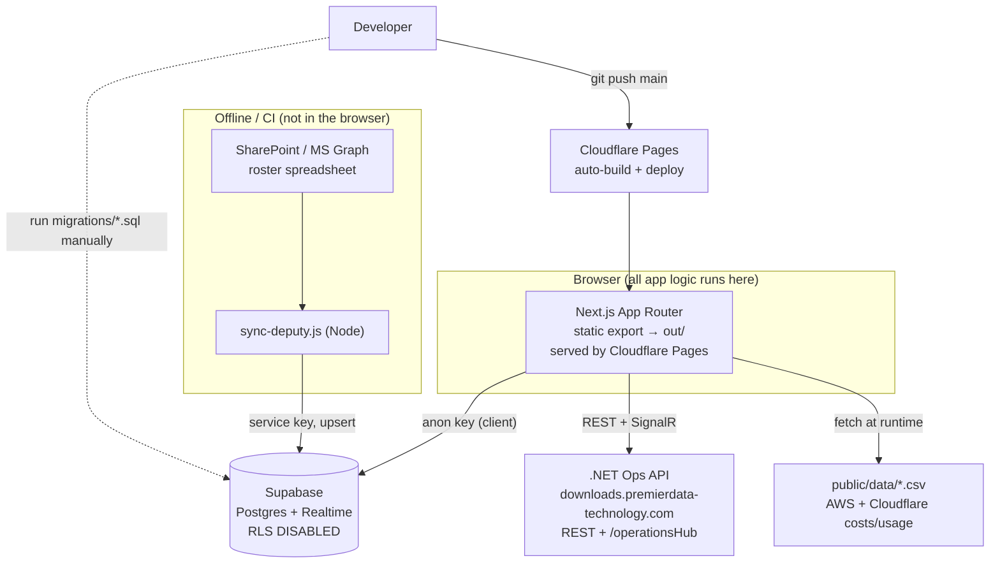

# Technical Architecture — Premier Data Platform (reporting-ui)

> Reference document describing how this project is structured. Written for
> developers picking up the codebase. Reflects the code as it stands, including
> a few known rough edges (flagged in [Known Issues](#12-known-issues--tech-debt)).

---

## 1. Overview

`reporting-ui` is the web front-end for the Premier Data Platform — an internal
operations and analytics dashboard for a sports-video analysis business. It
covers analyst management, live operations, accuracy grading of coded games,
cost reporting (AWS + Cloudflare), messaging, and role-based access.

It is a **Next.js 16 App Router** application (React 19, TypeScript, Tailwind
v4) built as a **static export** and served from **Cloudflare Pages** at
`dashboard.premierdata-technology.com`.

Because it is a static export, **there is no server runtime in production** —
all data access happens in the browser against two backends:

- **Supabase** (Postgres + Realtime) via the public **anon key**, for
  reporting, auth, accuracy checks, disputes, and messaging.
- An external **.NET operations API** (`downloads.premierdata-technology.com`)
  over REST + **SignalR**, for the live board, computers, fixtures, and
  analyst allocation.

---

## 1a. Quick Start (local setup from zero)

For a new developer taking over. Requires **Node 20+** and **git**.

```bash
# 1. Clone
git clone https://github.com/alphahawk01/Reporting-Dashboard.git
cd Reporting-Dashboard/reporting-ui      # the Next.js app lives in this subfolder

# 2. Install dependencies
npm install

# 3. Environment (see keys below) — create the two env files
#    .env.local  → client-side (NEXT_PUBLIC_*), read by the browser
#    .env        → server/sync scripts (Supabase service key, Azure/Graph)
#    Ask an existing dev / super admin for the real values.

# 4. Run the dev server
npm run dev                               # http://localhost:3000

# 5. Log in
#    Seeded super admin: username "andydin", password "andydin"
#    (from migrations/create_user_accounts.sql — change it in production)
```

**`.env.local` (client) — minimum to run the app:**

```dotenv
NEXT_PUBLIC_SUPABASE_URL=https://<project>.supabase.co
NEXT_PUBLIC_SUPABASE_ANON_KEY=<anon key>
# Optional (LMS provisioning on the Users page):
NEXT_PUBLIC_LMS_URL=<lms base url>
NEXT_PUBLIC_LMS_PROVISION_SECRET=<shared secret>
```

**`.env` (only needed to run the Deputy roster sync script, not the app):**

```dotenv
SUPABASE_URL=https://<project>.supabase.co
SUPABASE_SERVICE_KEY=<service role key>
AZURE_TENANT_ID=… AZURE_CLIENT_ID=… AZURE_CLIENT_SECRET=…
SITE_ID=… DRIVE_ID=… FILE_ID=…   # SharePoint roster source
DIRECT_DOWNLOAD_URL=<sharepoint file url>
```

**First-run notes**

- The app talks to **Supabase directly from the browser** with the anon key —
  no local backend is needed to develop. Point it at the existing Supabase
  project (or your own — then run every `migrations/*.sql` in the Supabase SQL
  editor to create the schema and seed the super admin + permission matrix).
- **Live-ops pages** (`/operations`, `/computers`, `/fixtures`) call the
  external .NET API at `downloads.premierdata-technology.com` (hardcoded in
  `lib/api/config.ts`). Those pages won't load data unless that API is
  reachable; the rest of the app (accuracy, reporting, analysts, cost tabs)
  works against Supabase + the CSVs alone.
- **Cost tabs** read CSVs from `public/data/` (`aws-costs.csv`,
  `cloudflare_costs.csv`, `cloudflare_usage.csv`) — already in the repo, no
  setup needed.
- Type-check any change with `npx tsc --noEmit` before committing.

**Deploy:** push to `main` → Cloudflare Pages auto-builds the static export and
publishes to `dashboard.premierdata-technology.com` (see §10). Schema changes
are applied separately by running `migrations/*.sql` in Supabase.

---

## 2. Tech Stack

| Concern | Choice |
| --- | --- |
| Framework | Next.js 16 (App Router), output: `export` (static) |
| UI | React 19, Tailwind CSS v4 (`@tailwindcss/postcss`) |
| Language | TypeScript 5 (strict), path alias `@/* → ./*` |
| Charts | Recharts 3 |
| Data (primary) | Supabase (`@supabase/supabase-js`), anon key |
| Data (ops) | External .NET API + SignalR (`@microsoft/signalr`) |
| Spreadsheets | `xlsx` (Deputy roster sync), CSVs in `public/data` |
| HTTP | `fetch` (browser), `axios` (Node sync scripts) |
| Icons | `lucide-react` |
| Hosting | Cloudflare Pages (auto-deploy on push to `main`) |

---

## 3. High-Level Diagram



Key consequence: **data fetching is entirely client-side**. There is no
Next.js server or API route in production (`app/api/tt-data` is empty). The
browser holds the Supabase anon key and talks to every backend directly.

---

## 4. Directory Layout

```
reporting-ui/
├── app/                 # App Router routes (one folder per page)
│   ├── layout.tsx       # Root: <AuthProvider> → <AppShell>
│   ├── page.tsx         # Index (treated as "dashboard")
│   └── <route>/page.tsx # ~22 feature routes (see §5)
├── components/
│   ├── auth/            # AuthContext (session/roles), AppShell (route guard)
│   ├── layout/          # Sidebar, Topbar, PageContainer (app chrome)
│   ├── operations/      # Live board pieces
│   ├── recommendations/ # AI recommendation UI
│   ├── chat/            # ChatWidget
│   ├── UI/              # Card, StatBar, tabs primitive
│   ├── DashboardClient.tsx  # The tabbed reporting dashboard
│   ├── AwsCosts.tsx / CloudflareCosts.tsx / TTGames.tsx  # cost/analytics tabs
│   └── … (Recharts chart components)
├── lib/
│   ├── supabase.ts      # Supabase client (anon key)
│   ├── signalr.ts       # SignalR hub singleton
│   ├── api/             # Data-access layer, grouped by domain (see §6)
│   ├── comparison/      # SportsCode XML parse + compare + player accuracy
│   ├── aws/costs.ts     # AWS cost CSV parser + aggregation
│   ├── cloudflare/costs.ts  # Cloudflare cost CSV + usage derivation
│   ├── analytics/       # Analyst metrics + benchmarks
│   ├── recommendations/ # Recommendation engine + scoring
│   └── data/            # Deputy roster loader
├── migrations/          # Supabase schema (SQL, run manually)
├── public/data/         # AWS + Cloudflare CSVs (fetched client-side)
├── public/CNAME         # dashboard.premierdata-technology.com
├── sync-deputy.js       # Node script: SharePoint → Supabase roster (service key)
├── next.config.js       # output: "export"
└── docs/ARCHITECTURE.md # this file
```

---

## 5. Routing (`app/`)

Root `app/layout.tsx` wraps the tree in `<AuthProvider>` then `<AppShell>`
(the client-side auth guard + nav chrome). `/` maps to the `dashboard` page key.

| Route | Purpose | Backend |
| --- | --- | --- |
| `/login` | **Only public route.** Username/password form. | Supabase |
| `/dashboard`, `/` | Tabbed operational dashboard (`DashboardClient`). | mixed |
| `/reporting` | The reporting entry: loads Deputy + TT data, renders `DashboardClient`. | Supabase/CSV |
| `/operations` | Live board of analyst/computer status. | .NET API + SignalR |
| `/computers` | Computer inventory + analyst allocation. | .NET API |
| `/fixtures`, `/competitions`, `/schedule` | Fixtures / competitions / scheduling. | .NET API |
| `/recommendations` | AI analyst-to-fixture recommendation engine. | Supabase + `lib/recommendations` |
| `/analyst-management` | CRUD analysts, reassign computers. | Supabase + .NET |
| `/analyst-profile` | Per-analyst profile dashboards (analysts land here). | Supabase |
| `/analyst-compare` | Side-by-side analyst comparison (radar/KPIs/trends). | Supabase |
| `/leaderboard` | Analyst metrics leaderboard. | Supabase |
| `/affiliated-teams` | Team ↔ analyst auto-download mapping. | .NET API |
| `/accuracy-compare` | **SportsCode XML comparison tool** (largest page). | Supabase |
| `/accuracy-checks` | Accuracy history + trends for graded analysts. | Supabase |
| `/disputes` | Global dispute review (admin confirm/deny). | Supabase |
| `/messages` | Direct/group messaging. | Supabase (Realtime) |
| `/users` | Super-admin account management + LMS provisioning. | Supabase + LMS |
| `/permissions` | Super-admin role→page permission matrix editor. | Supabase |
| `/downloads`, `/notifications`, `/settings` | Stub/placeholder pages. | — |

---

## 6. Data / API Layer (`lib/api/`)

A single Supabase client (`lib/supabase.ts`) is created from
`NEXT_PUBLIC_SUPABASE_URL` + `NEXT_PUBLIC_SUPABASE_ANON_KEY`. **No Supabase
Auth is used, and Row-Level Security is disabled on every table** (open
read/write with the anon key — see [§9](#9-auth--permissions)).

The external .NET API base lives in `lib/api/config.ts` (dev
`http://localhost:5165`, prod `https://downloads.premierdata-technology.com`).

| Module | Domain | Backend |
| --- | --- | --- |
| `auth.ts` | Roles, `PAGES` registry, `role_permissions` CRUD, SHA-256 login | Supabase |
| `accuracyChecks.ts` | Save/list/soft-delete accuracy checks; on-demand XML; master propagation; player-accuracy backfill | Supabase |
| `disputes.ts` | Flag/resolve instance disputes (open/confirmed/denied) | Supabase |
| `messages.ts` | Conversations, members, messages (direct + group) | Supabase Realtime |
| `analysts.ts` | Analyst records + allocation types | Supabase + .NET |
| `awsCostCategories.ts` | Usage-type → category override map | Supabase |
| `computers.ts`, `operations.ts`, `fixtures.ts`, `assignFixture.ts`, `autodownload.ts`, `downloadJobs.ts` | Live ops / fixtures / downloads | .NET API |
| `lmsProvision.ts` | Provision training LMS accounts | External LMS |

### The 1000-row pagination pattern

Supabase caps a single `select` at ~1000 rows. List functions therefore loop
with `.range()`:

```ts
const pageSize = 1000;
let from = 0;
while (true) {
  const { data } = await supabase.from(t).select(...).range(from, from + pageSize - 1);
  if (!data?.length) break;
  rows.push(...data);
  if (data.length < pageSize) break;
  from += pageSize;
}
```

Used in `getAllAccuracyChecks`, `getAccuracyChecksMeta`, `getAllDisputes`,
`getOpenDisputeCounts`, and similar. **This matters:** an unpaged select
silently drops rows past 1000, which previously caused missing dispute badges.

---

## 7. Domain Logic (`lib/`)

### 7.1 Accuracy grading — `lib/comparison/`

The core of the product. Compares a "master" (correct) SportsCode XML against an
analyst's XML.

- **`xml-compare.ts`**
  - `parseInstances(xml)` — parses `<ALL_INSTANCES><instance>` (start/end
    seconds, `<code>`, `<label><group>` Team/Player/Stat). Computes a **code
    time** (`mid`) — the moment within the lead/lag window, adjusted per stat
    (e.g. corners `start + 5s`, goals `start + 45s`).
  - `canonicaliseTeams(master, analyst, tolerance, fileName)` — relabels both
    files' teams to canonical **Home/Away** so mismatched club naming doesn't
    cause false "wrong team". Home/Away is taken from the **master file name**
    (`..._<marker>_<Home>_<Away>.xml`, where marker = `full`/`Q1–Q4`/`H1–H2`/
    `GF`/`SF`/`QF`), with a name-similarity fallback. Includes an **idempotency
    guard**: already-canonical instances pass through unchanged (prevents a
    second pass from re-flipping Home/Away).
  - `compareInstances(...)` — matches instances within a time tolerance and
    classifies each row as `exact | wrong_stat | wrong_player | wrong_team |
    missed | extra`, returning a summary + `byCategory` / `byStat` / `byTeam`
    breakdowns.
- **`player-accuracy.ts`** — groups exact-match accuracy into
  **Passing / Offensive / Defensive / Goalkeeper / Other** (football).
  `Other` (touches, carries, dribbles, throw-ins, cards, fouls, offside) is a
  **standalone %** — excluded from Overall, unless a check has *only* Other-type
  stats (then Overall falls back to it). Computed per scope (both/home/away)
  and stored on the check as `player_accuracy` JSON.
- **`insights.ts`** — narrative insights from a comparison result.

**Storage model:** each `accuracy_checks` row stores the **full master + analyst
XML blobs** so a saved check can be fully re-opened and re-graded. Because
these blobs are large:
- list views select a **projection without the XML** (`getAccuracyChecksMeta`),
- XML is fetched **on demand, one row per request** (`getAccuracyChecksXml`) to
  avoid Postgres statement timeouts,
- re-grading (`propagateMasterCorrection`, `backfillPlayerAccuracy`) recomputes
  from the stored XML and rewrites the derived columns.

### 7.2 Cost reporting

- **`lib/aws/costs.ts`** — parses the AWS Cost Explorer "cost by Usage Type"
  pivoted daily CSV. Converts **USD → AUD (`USD_TO_AUD = 1.4`)** at parse time,
  drops usage types averaging `< A$0.50/day`, and rolls usage types into
  business categories (built-in `USAGE_TYPE_CATEGORY`, overridable via Supabase
  `aws_cost_categories`; uncategorised → `"Other"`). Aggregates to
  daily / weekly (Fri→Thu) / monthly. Dates accept ISO or `D/M/YYYY`
  (zero-padded to survive validation — first-of-month rows were previously
  dropped).
- **`lib/cloudflare/costs.ts`** — parses `cloudflare_costs.csv` (one row per
  13th→12th billing window). Rate-adjusts by `CLOUDFLARE_RATE = 1.4`. Splits
  fixed `base` (Service Cost) vs usage-driven `excess`. **Derives usage in TB**
  from excess charges using effective-dated pricing tiers (Tier 1 pre-13 May:
  60 TB data / 40 TB storage; Tier 2 from 13 May: 80 / 60 TB; excess at
  USD $94.891/TB data, $15/TB storage). When `cloudflare_usage.csv` (daily TB)
  is present, exact data transfer is summed over each billing window and
  preferred over the derived figure.

### 7.3 Other domain libs

- `lib/analytics/` — `buildAnalystMetrics`, `buildAnalystBenchmark`, rating
  colours, excluded-analyst rules.
- `lib/recommendations/` — analyst-to-fixture scoring engine (league
  experience, availability, weights).
- `lib/api/deputyShifts.ts` — the single data layer for Deputy shifts and rosters. All Deputy data comes from the Deputy API (the `deputy` schema): the name-free view `weekly_report_shifts` for the Weekly Report, and the `deputy-read` edge function for employee-level pages. Nothing reads the Excel-loaded Deputy tables; `lib/deputy/noExcelDeputyReads.test.ts` enforces that. Deputy history is loaded in full (all history since 2025-03).
- `lib/analytics/season.ts` — the single week rule: weeks run Wed to Tue, season N starts on the Wednesday on or before 1 Oct of year N-1 (Week 1), there is no Week 0 and a season can have 53 weeks (2025). Deputy shifts, `TT_Games` and `soccer_games` all derive season/week from their date with it (stored `Week`/`season` columns are only a last fallback). SQL twin: migration 005 functions; JS twin: `sync-deputy.js`. Cross-season maths uses `absoluteWeekIndex`.

---

## 8. Data Sources

### 8.1 Supabase schema (`migrations/`)

Migrations are plain SQL, **run manually in the Supabase SQL editor**,
idempotent (`if not exists`), and **all tables have RLS disabled**.

| Migration | Tables / changes |
| --- | --- |
| `create_user_accounts.sql` | `user_accounts`, `role_permissions`; seeds super admin + default matrix |
| `add_user_accounts_email.sql` | `user_accounts.email` |
| `create_accuracy_checks.sql` | `accuracy_checks` (metrics + `category_breakdown`/`team_breakdown` jsonb) |
| `add_accuracy_checks_xml.sql` | `xml_master`, `xml_analyst`, `video_url`, `sport` |
| `add_soft_deletes.sql` | `deleted_at`/`deleted_by` on checks + disputes (soft delete) |
| `fix_accuracy_checks_rls.sql` | documents RLS-disabled posture |
| `create_accuracy_disputes.sql` | `accuracy_disputes` (FK to checks, status, resolution) |
| `add_accuracy_disputes_category.sql` | dispute `category` |
| `grant_analyst_disputes.sql` | dispute permission tweak |
| `create_messages.sql` | `conversations`, `conversation_members`, `messages` |
| `create_analysts.sql` | `analysts` |
| `create_aws_cost_categories.sql` | `aws_cost_categories` (usage-type → category) |
| `seed_analyst_accounts.sql` | seeds analyst logins |

### 8.2 CSV files (`public/data/`)

`aws-costs.csv`, `cloudflare_costs.csv`, `cloudflare_usage.csv` — fetched by the
browser at runtime and parsed by the `lib/aws` / `lib/cloudflare` parsers. To
update the dashboards, replace the CSV and redeploy.

### 8.3 External integrations

- **Deputy roster sync** (`sync-deputy.js` / `syncDeputyRoster.js`) — Node
  scripts (run offline/CI) that pull the roster spreadsheet from
  SharePoint/OneDrive via Microsoft Graph and upsert into Supabase using the
  **service key** (chunked, logs to `sync_logs`).
- **SignalR** (`lib/signalr.ts`) — connects to `<API>/operationsHub` for the
  live operations board.
- **Microsoft Graph / Azure** — `.env` `AZURE_*`, `SITE_ID/DRIVE_ID/FILE_ID`,
  `DIRECT_DOWNLOAD_URL` (used by the sync script).
- **LMS provisioning** — `lib/api/lmsProvision.ts` POSTs to the training LMS
  with a shared secret.

---

## 9. Auth & Permissions

- **Roles:** `analyst | admin | super_admin` (`lib/api/auth.ts`).
- **Login:** looks up `user_accounts` by case-insensitive username and verifies
  `SHA-256(salt + password)` (with a pure-JS SHA-256 fallback for non-HTTPS
  contexts). **No Supabase Auth** — explicitly a "lightweight UI-level gate."
- **Permission model:** the `PAGES` registry (`{key, label, href}`, ~22 pages)
  plus the `role_permissions` table drive access. `AuthContext` loads the matrix
  into `permissions[role][pageKey]`; `hasAccess` returns true for `super_admin`
  always, else the matrix value.
- **Enforcement:** `components/auth/AppShell.tsx` guards navigation —
  unauthenticated → `/login`; logged-in-but-no-access → first accessible page;
  no accessible pages → "No pages available". The Sidebar hides inaccessible
  links. Session is persisted in `localStorage` (`pd_auth_user`).
- **Landing:** after login, an allocated analyst goes to their own
  `/analyst-profile`; everyone else to their first accessible page.

> ⚠️ **This is UI-level only.** RLS is disabled and the anon key ships in the
> static bundle, so the tables are readable/writable by anyone with the key
> regardless of role. The role model controls only what the UI shows.

---

## 10. Build & Deploy

- **Build:** `next build` with `output: "export"` emits a static site to
  `out/`. `public/CNAME` sets the custom domain.
- **Deploy:** **Cloudflare Pages**, auto-deploying on push to `main`
  (GitHub repo `alphahawk01/Reporting-Dashboard`). A `git push` *is* the
  deploy — there is no manual build/deploy step.
- **Migrations** are applied separately by running the relevant
  `migrations/*.sql` in the Supabase SQL editor.
- The `package.json` `deploy: gh-pages -d out` script and the `.open-next/` /
  `.wrangler/` directories are **stale/unused** (earlier experiments); the live
  pipeline is Cloudflare Pages from the static export.

---

## 11. Configuration

- **`tsconfig.json`** — strict, `noEmit`, `moduleResolution: bundler`, path
  alias `@/* → ./*`.
- **`eslint.config.mjs`** — flat config extending `eslint-config-next`
  (core-web-vitals + TypeScript).
- **Tailwind v4** — `@tailwindcss/postcss`; `app/globals.css` uses the v4
  `@import "tailwindcss"` + `@theme inline` syntax.
- **Environment variables:**
  - Client (`.env.local`, `NEXT_PUBLIC_*`): `NEXT_PUBLIC_SUPABASE_URL`,
    `NEXT_PUBLIC_SUPABASE_ANON_KEY`, `NEXT_PUBLIC_LMS_URL`,
    `NEXT_PUBLIC_LMS_PROVISION_SECRET`.
  - Server/sync (`.env`): `SUPABASE_URL`, `SUPABASE_SERVICE_KEY`, `AZURE_*`,
    `SITE_ID/DRIVE_ID/FILE_ID`, `DIRECT_DOWNLOAD_URL`.
  - The .NET API base + SignalR hub URL are hardcoded in `lib/api/config.ts` /
    `lib/signalr.ts` (not env-driven).

---

## 12. Known Issues & Tech Debt

1. **UI-only auth + RLS disabled.** Data is not actually protected server-side;
   anyone with the public anon key can read/write tables. Consider real RLS +
   Supabase Auth if the data is sensitive.
2. **Secrets committed** in `.env` / `.env.local` (Supabase service key, Azure
   client secret, LMS shared secret). These should be rotated and moved to
   Cloudflare Pages / CI secrets.
3. **No server-side validation.** All grading/aggregation runs client-side;
   bulk data fixes are done via one-off scripts against Supabase.
4. **Duplicated config / dead code:** API base URL is copy-pasted across a few
   modules; some stub routes export a misnamed `OperationsPage`; `DashboardClient`
   has leftover debug logging; stale `gh-pages` script, boilerplate `README.md`,
   and `.open-next`/`.wrangler` dirs.
5. **`sync_logs`** table referenced by `sync-deputy.js` has no migration in
   `migrations/`.

---

## 13. Common Tasks

| Task | How |
| --- | --- |
| Run locally | `npm run dev` (localhost:3000) |
| Deploy | `git push origin main` (Cloudflare Pages auto-builds) |
| Apply a schema change | run the `migrations/*.sql` in the Supabase SQL editor |
| Update AWS/Cloudflare figures | replace the CSV in `public/data/`, redeploy |
| Add a page to the permission system | add to `PAGES` in `lib/api/auth.ts` + seed `role_permissions` |
| Re-grade accuracy checks after a logic change | run the backfill/propagate path (admin "Recompute all") |
| Type-check | `npx tsc --noEmit` |
```
