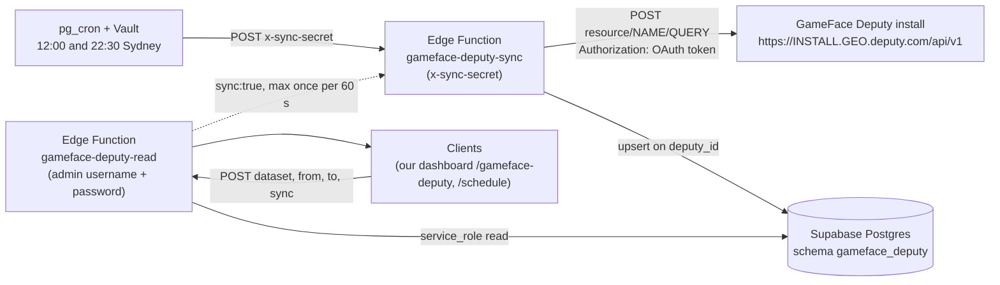

# GameFace Deputy integration: technical specification

Audience: a developer integrating GameFace's Deputy roster, timesheet and leave data into another platform. This document describes two ways to do it: **Option A** (call Deputy directly) and **Option B** (use the Supabase Edge Functions we already run).

Everything below was taken from the code in `reporting-ui` (`supabase/functions/gameface-deputy-sync/`, `gameface-deputy-read/`, `deputy-read/shape.ts`, `deputy-sync/query.ts`, `deputy-sync/mappers.ts`, `deputy-sync/reconcile.ts`, `_shared/deputySchema.ts`, `migrations/014_gameface_deputy.sql`, `lib/api/gamefaceDeputy.ts`) and the design notes in `.agents/tasks/deputy-second-company/`. Statements marked **(inferred)** are not confirmed by code or by a live run. Statements marked **(owner-stated)** come from the product owner and cannot be checked from the code.

Placeholders used throughout: `<INSTALL>`, `<GEO>`, `<DEPUTY_ACCESS_TOKEN>`, `<PROJECT_REF>`, `<SYNC_SECRET>`, `<SUPABASE_ANON_KEY>`, `<ADMIN_USERNAME>`, `<ADMIN_PASSWORD>`. No real value appears in this document and none should be added.

## Table of contents

1. [Overview and data flow](#1-overview-and-data-flow)
2. [Option A: direct Deputy API integration](#2-option-a-direct-deputy-api-integration)
3. [Option B: consuming our existing endpoints](#3-option-b-consuming-our-existing-endpoints)
4. [Data model](#4-data-model)
5. [Data protection](#5-data-protection)
6. [Sync schedule and windows](#6-sync-schedule-and-windows)
7. [Example requests and responses](#7-example-requests-and-responses)
8. [Known limitations and gotchas](#8-known-limitations-and-gotchas)

---

## 1. Overview and data flow

GameFace is a second company with its own Deputy install (an Australian install, so the host ends in `.au.deputy.com`; the install name is not printed here). We copy a rolling window of its data into our own Postgres schema `gameface_deputy` and serve it to our dashboard. Only Deputy read calls are made. Nothing is ever created, edited, deleted or approved in GameFace's Deputy.



Steps:

1. `gameface-deputy-sync` calls Deputy `QUERY` endpoints for six resources: Company, OperationalUnit, Employee, Roster, Timesheet, Leave.
2. Each record is mapped to a table row and scrubbed of personal fields (section 5), then upserted by `deputy_id`.
3. After a successful Roster sync, rosters in the window that Deputy no longer returns are soft-deleted (`is_deleted = true`).
4. `gameface-deputy-read` re-checks an admin username and password in SQL, then returns rosters or approved timesheets from the schema.

The schema is locked to `service_role`. The `anon` and `authenticated` roles have no privilege on it and RLS is enabled on every table with no policies. A client can only reach the data through the read function.

---

## 2. Option A: direct Deputy API integration

Use this if your platform wants to call GameFace's Deputy itself and keep its own copy. You need your own Deputy access token from GameFace (section 2.2). Our Edge Functions are not involved.

### 2.1 Base URL

```
https://<INSTALL>.<GEO>.deputy.com/api/v1
```

GameFace is an AU install, so `<GEO>` is `au`. Our sync accepts only `https`, a host ending in `.deputy.com`, no credentials, port, query or fragment in the URL, and the exact path `/api/v1`. This stops the token being sent to any other host. Apply the same check in your platform.

### 2.2 Authentication

- Create a **permanent access token**. A Deputy **System Administrator** opens the install's OAuth client page and uses **Get An Access Token**.
- The token acts as the user who created it and sees only what that user can see. If the user cannot see Leave, the Leave query is refused (section 8).
- Our sync sends the header `Authorization: OAuth <DEPUTY_ACCESS_TOKEN>`. That is what the code does and what has been designed against. Deputy also documents `Authorization: Bearer <token>` for the same token **(inferred, not exercised by our code)**. Use `OAuth` if you want to match the behaviour we have tested.
- Send `Content-Type: application/json` and `Accept: application/json`.
- Store the token in a secret store. Never log headers, bodies or the token. Our sync puts only the HTTP status code in error messages.

### 2.3 Read-only usage

Deputy's `QUERY` endpoint is a `POST` that only reads. Our code builds the URL in a single function that can only produce `<base>/resource/<Name>/QUERY` for the six names below, so no write path exists. Do the same in your platform. Use a Deputy user with the least rights that can read these resources.

### 2.4 Endpoints

All requests are `POST <base>/resource/<Name>/QUERY` with a JSON body. Resource names are case-sensitive.

| Resource | URL | Date filter field | Stored in table |
| --- | --- | --- | --- |
| Company | `/resource/Company/QUERY` | none | `companies` |
| OperationalUnit | `/resource/OperationalUnit/QUERY` | none | `operational_units` |
| Employee | `/resource/Employee/QUERY` | none | `employees` |
| Roster | `/resource/Roster/QUERY` | `Date` | `rosters` |
| Timesheet | `/resource/Timesheet/QUERY` | `Date` | `timesheets` |
| Leave | `/resource/Leave/QUERY` | `DateStart` | `leave_records` |

Sync order is Company, OperationalUnit, Employee, Roster, Timesheet, Leave.

### 2.5 Request body

Every request sorts by `Id` ascending so paging is stable, and always includes the condition `Id > 0`. Resources with a date field add a range.

Roster, one page, window 2026-01-01 to 2026-01-31 inclusive (note the `lt` bound is the day after the end date):

```json
{
  "search": {
    "s1": { "field": "Id",   "type": "gt", "data": 0 },
    "s2": { "field": "Date", "type": "ge", "data": "2026-01-01" },
    "s3": { "field": "Date", "type": "lt", "data": "2026-02-01" }
  },
  "start": 0,
  "max": 500,
  "sort": { "Id": "asc" }
}
```

Company, OperationalUnit and Employee omit `s2` and `s3`. Leave uses `DateStart` instead of `Date`.

Rules the code applies:

- `s2` (`ge`) is added only when a start date is supplied, `s3` (`lt`) only when an end date is supplied.
- Callers treat the end date as inclusive. Deputy's filter is `Date < to`, so the sync sends the **day after** the end date. Without this, shifts on the last day are missed.
- The date filter is applied by Deputy's own `Date` field (a local calendar date).

### 2.6 Pagination

- Page size `max` = **500**. Offset `start` = `page * 500`.
- Stop when a page returns fewer than 500 records, or none. Do not rely on a total-count field. The sync does not use one.
- Hard ceiling of **200 pages** per resource per run (100,000 records).
- Response body is a JSON array of records. Our parser also accepts `{data|result|results|records: [...]}` as a defensive measure; the confirmed shape is a bare array.

### 2.7 Rate limiting and retries (as implemented)

- Each request has a **30 second** timeout.
- Up to **5 attempts** per page.
- Retry on HTTP **429, 500, 502, 503, 504**.
- Never retry **400, 401, 403**. The sync fails that resource with `deputy_<status>`.
- Wait time: if the response has a `Retry-After` header with a positive number of seconds, wait that long (capped at 60 s). Otherwise exponential backoff with full jitter: a random value between 0 and `min(1000 * 2^attempt, 30000)` ms.
- Pages are fetched one at a time (no parallel requests).
- Deputy's actual rate limits are not documented in our code. Treat the above as a safe minimum.

### 2.8 Time zones

- GameFace is treated as **Australia/Sydney**. The check is the dry run's `dateMismatches` (section 3.4), which must be `0` for Roster and Timesheet. A non-zero count means the company is not on Sydney time and the date bucketing needs to change.
- `StartTime` and `EndTime` on Roster and Timesheet are **epoch seconds** (UTC instants). We store them raw (`start_time_epoch`, `end_time_epoch`) and as UTC timestamps (`start_at`, `end_at`).
- The calendar day of a shift (`roster_date`, `timesheet_date`) is the **Sydney local date of `StartTime`**, computed with the `Australia/Sydney` zone so daylight saving (+10 / +11) is handled. A shift starting at 21:00 UTC lands on the next Sydney day. If `StartTime` is missing, the date part of Deputy's `Date` field is used.
- Deputy also returns "Localized" variants of some fields **(inferred)**. Our code does not read them. Use the epoch fields and convert to Sydney yourself.
- Do not bucket by UTC date. That puts evening shifts on the wrong day.

---

## 3. Option B: consuming our existing endpoints

### 3.1 Current access model (read this first)

`gameface-deputy-read` requires an **admin username and password**. The function calls `public.gameface_deputy_check_admin(username, password)` with the service-role key, which re-checks the password in SQL (via `activity_assert_admin`, migration 011). It also needs the Supabase anon key as a bearer token because the function is deployed with JWT verification on.

This is designed for our own dashboard, where an admin types their password into the page. **It is not suitable for machine-to-machine use by a third-party platform.** It would mean sharing a human admin's password, there is no per-integration revocation, and the password travels in every request body. See [Open decision](#open-decision-a-credential-for-third-party-platforms).

`gameface-deputy-sync` is protected by a shared secret (`x-sync-secret`) and is meant for our cron job and our operators. Do not hand that secret to a third party: it triggers writes into our database and Deputy calls under our token.

### 3.2 gameface-deputy-read

```
POST https://<PROJECT_REF>.functions.supabase.co/gameface-deputy-read
```

(The dashboard uses `<SUPABASE_URL>/functions/v1/gameface-deputy-read`, which is the same function.)

**Methods.** `POST` only. `OPTIONS` returns 204 with CORS headers. Any other method returns 405 `method_not_allowed`.

**Headers**

| Header | Value |
| --- | --- |
| `Authorization` | `Bearer <SUPABASE_ANON_KEY>` (required by Supabase JWT verification) |
| `apikey` | `<SUPABASE_ANON_KEY>` |
| `Content-Type` | `application/json` |

**Body**

| Field | Type | Required | Meaning |
| --- | --- | --- | --- |
| `username` | string | yes | Admin username. Non-empty after trim. |
| `password` | string | yes | Admin password. Non-empty. Never put it in the URL. |
| `dataset` | `"rosters"` or `"timesheets"` | yes | Which table to read. |
| `from` | `yyyy-mm-dd` string | no | Inclusive lower bound on `roster_date` / `timesheet_date`. |
| `to` | `yyyy-mm-dd` string | no | Inclusive upper bound. |
| `sync` | boolean | no | `true` asks the function to refresh from Deputy first (section 3.2.2). Any other value is treated as false. |

Date rules: each must be a real calendar date in `yyyy-mm-dd` form. An empty string is invalid (omit the field or send `null` instead). `from` must not be after `to`. The span must not exceed **400 days**. Without `from` and `to`, all stored rows for the dataset are returned.

**Response (200)**

```json
{ "rows": [ { "...": "..." } ], "synced": false }
```

`synced` is `true` only if a refresh was attempted and the sync function answered HTTP 200. Rows are sorted by date descending. Rows are read in pages of 1,000 up to a safety ceiling of **20,000 rows**. If a range holds more than that, narrow it with `from` and `to` (the cap is silent: the function does not report truncation).

**Row fields, `rosters`** (only non-deleted rows, `is_deleted = false`, published **and** unpublished):

`deputy_id`, `roster_date`, `start_at`, `end_at`, `total_time`, `published`, `open_shift`, `employee_deputy_id`, `operational_unit_deputy_id`, plus two added fields: `employee_name`, `operational_unit_name`.

**Row fields, `timesheets`** (only `time_approved = true` and `discarded` null or false, enforced by the function):

`deputy_id`, `timesheet_date`, `start_at`, `end_at`, `total_time`, `mealbreak_minutes`, `cost`, `on_cost`, `time_approved`, `pay_rule_approved`, `disputed`, `is_leave`, `employee_deputy_id`, `operational_unit_deputy_id`, plus `employee_name`, `operational_unit_name`.

**Name resolution.** `employee_name` is `first_name last_name` if present, else `display_name`, else the raw Deputy employee id, else null. `operational_unit_name` is the unit name, or the raw unit id if the name is missing. A missing reference row never fails the request.

**Not returned by this function:** leave records, companies, `source_data`, `cost`/`on_cost` on rosters, `mealbreak_minutes` on rosters. The read function does not expose them. Use the database directly or add a dataset (section 3.5).

#### 3.2.1 Errors

| HTTP | Body | Cause |
| --- | --- | --- |
| 400 | `{"error":"bad_request"}` | Body is not valid JSON, not an object, or `username` / `password` missing or empty. |
| 400 | `{"error":"unknown_dataset"}` | `dataset` is not `rosters` or `timesheets`. |
| 400 | `{"error":"invalid_date"}` | Bad `from` / `to`: not a real date, empty string, `from` after `to`, or span over 400 days. |
| 403 | `{"error":"forbidden"}` | Admin check failed (wrong credentials or not an admin). No data returned. |
| 405 | `{"error":"method_not_allowed"}` | Not POST or OPTIONS. |
| 500 | `{"error":"server_misconfigured"}` | `SUPABASE_URL` or service key missing on the function. |
| 500 | `{"error":"query_failed"}` | Database query failed. |
| 502 | `{"error":"upstream_unavailable"}` | The admin check function errored (for example migration 014 not run). |
| 503 | `{"error":"gameface_deputy_schema_not_exposed","message":"The Supabase Data API is not exposing the 'gameface_deputy' schema. In Supabase: Project Settings -> Data API -> Exposed schemas, add 'gameface_deputy'."}` | The schema is not in the Data API exposed list (section 8). The function retries 3 times (waits 500 ms and 1500 ms) before returning this. |

A missing or invalid `Authorization` bearer is rejected by the Supabase gateway before the function runs, so the body of that error is Supabase's, not ours **(inferred)**. A 404 from the gateway means the function is not deployed (our dashboard shows "GameFace Deputy functions are not deployed yet").

#### 3.2.2 The `sync` flag

With `"sync": true`, after the admin check passes the function:

1. Reads the latest `started_at` from `gameface_deputy.sync_runs`. If a run started less than **60 seconds** ago, it does not sync (`synced: false`).
2. Otherwise calls `gameface-deputy-sync` with all six resources, `mode: "manual"`, `dryRun: false`, and the window **today-13 to today+28 in Sydney dates**, with a 55 second timeout.
3. Continues to read and return data whether or not the refresh worked. It never fails the read because of a sync problem. It needs the `GAMEFACE_DEPUTY_SYNC_SECRET` environment variable on the read function; if absent, the sync is skipped silently (logged server-side).

### 3.3 CORS

The read function answers every response with `Access-Control-Allow-Origin: *`, `Access-Control-Allow-Methods: POST, OPTIONS`, `Access-Control-Allow-Headers: authorization, apikey, content-type`. Browsers can call it from any origin. The sync function sends **no** CORS headers and is not meant to be called from a browser.

### 3.4 gameface-deputy-sync

```
POST https://<PROJECT_REF>.functions.supabase.co/gameface-deputy-sync
```

Deployed with JWT verification off (`--no-verify-jwt`). The only gate is the `x-sync-secret` header.

**Headers**

| Header | Value |
| --- | --- |
| `x-sync-secret` | `<SYNC_SECRET>`, compared in constant time to the function's `GAMEFACE_DEPUTY_SYNC_SECRET` |
| `Content-Type` | `application/json` |

**Body (all fields optional)**

| Field | Type | Default | Meaning |
| --- | --- | --- | --- |
| `resources` | string[] | all six | Any of `Company`, `OperationalUnit`, `Employee`, `Roster`, `Timesheet`, `Leave`. Always run in the fixed order, whatever order you send. |
| `mode` | `"initial"`, `"incremental"`, `"reconcile"`, `"manual"` | `"manual"` | Recorded in `sync_runs.mode`. It does not change what is fetched. |
| `startDate` | `yyyy-mm-dd` | today-13 (Sydney) | Inclusive. Applies to Roster, Timesheet, Leave only. |
| `endDate` | `yyyy-mm-dd` | today+28 (Sydney) | Inclusive. Applies to Roster, Timesheet, Leave only. |
| `dryRun` | boolean | `false` | `true` reads from Deputy and reports, but writes nothing, not even a `sync_runs` row. |

A missing date falls back to the standard window so a run never pulls all history. A `mode` value outside the four allowed would be rejected by the database check on `sync_runs` **(inferred; the function does not validate it itself)**.

**Response**

```json
{
  "ok": true,
  "mode": "manual",
  "dryRun": false,
  "results": [
    {
      "resource": "Roster",
      "status": "succeeded",
      "dryRun": false,
      "read": 312,
      "written": 312,
      "skipped": 0,
      "error": null,
      "reconcile": { "action": "apply", "softDeleted": 2, "reason": "ok" }
    }
  ]
}
```

Per-result fields, real run: `resource`, `status` (`succeeded`, `partial`, `failed`), `dryRun`, `read`, `written`, `skipped`, `error`, and for Roster `reconcile` (`action` is `skip`, `apply` or `error`; `softDeleted`; `reason`).

Per-result fields, **dry run**: `resource`, `status`, `dryRun: true`, `read`, `skipped`, `minDate`, `maxDate`, `dateMismatches`, `droppedFieldNames`, `keptFieldNames`. On failure: `resource`, `status: "failed"`, `dryRun: true`, `error`.

| Dry-run field | Meaning |
| --- | --- |
| `read` | Records Deputy returned. |
| `skipped` | Records dropped before storage (duplicates by id, or no id). |
| `minDate`, `maxDate` | Earliest and latest mapped date (`roster_date`, `timesheet_date`, or Leave `date_start`). Null for resources without a date. |
| `dateMismatches` | Count of Roster/Timesheet rows whose Sydney-bucketed date differs from Deputy's own `Date`. Must be 0. |
| `droppedFieldNames` | Field names removed by the scrub (names only, never values). |
| `keptFieldNames` | Field names kept. Review this list for anything personal. |

**Status codes**

| HTTP | Body | Cause |
| --- | --- | --- |
| 200 | `ok: true` | No resource ended `failed`. A resource that ended `partial` still gives 200. |
| 207 | `ok: false` | At least one resource `failed`. The others still ran. `results` holds each outcome. |
| 400 | `{"error":"invalid_json"}` | Body is not JSON. |
| 400 | `{"error":"unknown_resources","unknown":["..."]}` | A name in `resources` is not one of the six. |
| 400 | `{"error":"invalid_date","value":"..."}` | `startDate` or `endDate` is not a real `yyyy-mm-dd` date. |
| 401 | `{"error":"unauthorized"}` | `x-sync-secret` missing or wrong. |
| 405 | `{"error":"method_not_allowed"}` | Not POST. |
| 500 | `{"error":"server_misconfigured"}` | `GAMEFACE_DEPUTY_BASE_URL` invalid or missing, or the token, Supabase URL or service key missing. |
| 500 | `{"ok":false,"error":"sync_failed","results":[...]}` | Unexpected error. |
| 503 | `{"ok":false,"error":"gameface_deputy_schema_not_exposed","message":"...","results":[...]}` | Schema not exposed. |

Per-resource `error` values are short codes such as `deputy_401`, `deputy_403`, `deputy_429`, `deputy_retry_exhausted`, `db_upsert: <message>`.

### 3.5 Manual backfill

A backfill is one call to the sync function with a wider window. The read function's `from`/`to` limit is 400 days, so keep each backfill call within a range you intend to read. Run in chunks to stay within the platform's request time limit **(inferred; not measured)**:

```powershell
$body = '{"resources":["Roster","Timesheet","Leave"],"mode":"manual","startDate":"2026-01-01","endDate":"2026-03-31","dryRun":false}'
```

Do a `dryRun: true` first and check `dateMismatches` and `keptFieldNames`. Reconciliation (soft-delete of vanished rosters) applies to whatever window you pass, so a narrow backfill does not touch rosters outside it.

### Open decision: a credential for third-party platforms

**Status: not implemented. This section is a recommendation for the product owner to decide.**

Problem. The only read path today needs an admin's username and password. A third-party platform cannot safely use it: it would hold a human's password, cannot be revoked without changing that password, has the same access as an admin, and sends the password in every request body.

Recommendation. Give integrations their own credential, separate from admin logins, and keep the dashboard flow unchanged. Two options:

1. **A separate read endpoint** (for example `gameface-deputy-api`) that accepts an `x-api-key` header, compares it in constant time to a stored secret (or a hash in a table), and reads with the service role. It would be read-only, limited to named datasets and a maximum date range, and independent from `gameface-deputy-read`.
2. **A key table** (`gameface_deputy.api_keys`: name, key hash, scopes, created, expires, revoked) checked by that endpoint. This allows one key per integration, revocation of a single key, a last-used timestamp, and rotation without a deploy.

Whichever is chosen: store only a hash, show the key once at creation, keep keys out of URLs and logs, add per-key rate limiting, and decide which fields the third party may see (in particular whether `cost`, `on_cost`, employee names and unpublished shifts are in scope). If the third party only needs the data and not our database, Option A (their own Deputy token) avoids this problem entirely and is the simpler choice.

---

## 4. Data model

Schema `gameface_deputy`. All eight tables are created `LIKE` the matching `deputy` table, so the structure is the same as our other Deputy company. All data tables share these columns: `id bigint` (identity, primary key), `deputy_id text not null unique` (the Deputy `Id` as text), `source_data jsonb not null` (the scrubbed Deputy record), `is_deleted boolean not null default false`, `synced_at timestamptz not null default now()`.

Reference columns (`employee_deputy_id`, `operational_unit_deputy_id`, and so on) hold the Deputy id as text. They are **soft keys**: there are no foreign keys between data tables, so a child row can load before its parent. Join them in your code on `deputy_id`. Missing values are `null`; the code never invents a default.

### 4.1 `rosters` (a planned shift)

| Column | Type | Deputy field | Meaning |
| --- | --- | --- | --- |
| `roster_date` | date | `StartTime` (Sydney date), else `Date` | Calendar day of the shift. |
| `employee_deputy_id` | text | `Employee` | Assigned employee. |
| `operational_unit_deputy_id` | text | `OperationalUnit` | Area or team. |
| `start_time_epoch`, `end_time_epoch` | bigint | `StartTime`, `EndTime` | Epoch seconds as returned. |
| `start_at`, `end_at` | timestamptz | `StartTime`, `EndTime` | The same instants as UTC timestamps. |
| `mealbreak_minutes` | numeric | `Mealbreak` | Unpaid break. |
| `total_time` | numeric | `TotalTime` | Shift hours as Deputy reports them. |
| `cost`, `on_cost` | numeric | `Cost`, `OnCost` | Deputy's calculated cost (see 4.7). |
| `published` | boolean | `Published` | True once the roster is published to staff. |
| `open_shift` | boolean | `Open` | True for an unassigned open shift. |
| `matched_by_timesheet` | boolean | `MatchedByTimesheet` | A timesheet exists for it. |
| `shift_template_id` | text | `ShiftTemplate` | |
| `external_id` | text | `ExternalId` | |
| `source_created_at`, `source_modified_at` | timestamptz | `Created`, `Modified` | |

Indexes: `roster_date`; `(employee_deputy_id, roster_date)`; `(operational_unit_deputy_id, roster_date)`; `source_modified_at`.

### 4.2 `timesheets` (worked time)

| Column | Type | Deputy field | Meaning |
| --- | --- | --- | --- |
| `timesheet_date` | date | `StartTime` (Sydney date), else `Date` | Calendar day. |
| `employee_deputy_id` | text | `Employee` | |
| `roster_deputy_id` | text | `Roster` | The roster it was worked against. |
| `operational_unit_deputy_id` | text | `OperationalUnit` | |
| `start_time_epoch`, `end_time_epoch`, `start_at`, `end_at` | bigint, timestamptz | `StartTime`, `EndTime` | As for rosters. |
| `mealbreak_minutes` | numeric | `Mealbreak` | |
| `total_time` | numeric | `TotalTime` | Hours. |
| `total_time_inv` | numeric | `TotalTimeInv` | |
| `cost`, `on_cost` | numeric | `Cost`, `OnCost` | See 4.7. |
| `time_approved` | boolean | `TimeApproved` | Timesheet approved by a manager. |
| `pay_rule_approved` | boolean | `PayRuleApproved` | Pay rules approved. |
| `discarded` | boolean | `Discarded` | Voided. |
| `disputed` | boolean | `Disputed` | |
| `is_leave` | boolean | `IsLeave` | Timesheet represents leave. |
| `leave_deputy_id` | text | `LeaveId` | |
| `supervisor_deputy_id` | text | `Supervisor` | |
| `exported` | boolean | `Exported` | Exported to payroll. |
| `external_id`, `source_created_at`, `source_modified_at` | | `ExternalId`, `Created`, `Modified` | |

Indexes: `timesheet_date`; `(employee_deputy_id, timesheet_date)`; `roster_deputy_id`; `source_modified_at`.

### 4.3 `leave_records`

`employee_deputy_id` (`Employee`), `company_deputy_id` (`Company`), `leave_rule_id` (`LeaveRule`), `start_at`, `end_at` (`Start`, `End`), `date_start`, `date_end` (`DateStart`, `DateEnd`, date part taken literally), `days` (`Days`), `total_hours` (`TotalHours`), `status` (`Status`, as text), `all_day` (`AllDay`), `approver_time` (`ApproverTime`), `approver_pay` (`ApproverPay`), `external_id`, `source_created_at`, `source_modified_at`. Indexes: `(employee_deputy_id, date_start, date_end)`, `status`, `source_modified_at`. Not returned by `gameface-deputy-read`.

### 4.4 `employees`

`display_name` (`DisplayName`), `first_name` (`FirstName`), `last_name` (`LastName`), `email` (**always null**, see section 5), `active` (`Active`), `company_id` (`Company`), `operational_unit_id` (`OperationalUnit`), `source_created_at`, `source_modified_at`. Indexes: `active`, `company_id`.

### 4.5 `companies` and `operational_units`

`companies`: `company_name` (`CompanyName`, else `TradingName`), `code` (`Code`), `active`, `is_workplace` (`IsWorkplace`), `is_payroll_entity` (`IsPayrollEntity`), `parent_company_id` (`ParentCompany`), created and modified timestamps.

`operational_units`: `operational_unit_name` (`OperationalUnitName`), `company_id` (`Company`), `parent_operational_unit_id` (`ParentOperationalUnit`), `work_type` (`WorkType`), `operational_unit_type` (`OperationalUnitType`), `active`, `show_on_roster` (`ShowOnRoster`), created and modified timestamps. Indexes: `company_id`, `active`. In Deputy's current API an "operational unit" is what the Deputy UI calls an area or department.

### 4.6 `sync_runs` and `sync_checkpoints`

`sync_runs`: `id`, `resource`, `mode` (`initial`, `incremental`, `reconcile`, `manual`), `status` (`running`, `succeeded`, `partial`, `failed`, `cancelled`), `requested_from`, `requested_to`, `started_at`, `finished_at`, `records_read`, `records_inserted` (rows written; inserts and updates are not separated, `records_updated` is always 0), `records_skipped`, `error_message`, `metadata` (jsonb: `dryRun`, and Roster `reconcile`). Index on `(resource, started_at desc)`.

`sync_checkpoints`: `resource` (primary key), `last_successful_modified_at`, `last_successful_run_id` (foreign key to `sync_runs.id`, `on delete set null`), `last_page_offset`, `updated_at`, `metadata`. Updated only when a resource run succeeds. The sync does not read the checkpoint; every run re-pulls its whole window.

### 4.7 Business rules

- **Published vs unpublished.** `rosters.published` is stored for every shift. The sync keeps unpublished (draft) shifts. `gameface-deputy-read` returns both and does **not** filter on `published`. A consumer that should show only what staff can see must filter `published = true` itself. Our own Schedule page does this on the client **(inferred from the product requirement "only show published shifts")**.
- **Open shifts.** `open_shift = true` and usually no `employee_deputy_id` **(inferred)**. In the read response `employee_name` is then null.
- **Approved timesheets.** The read function returns only `time_approved = true` and not discarded. The table holds all synced timesheets, including unapproved ones.
- **Leave.** Stored in `leave_records` when the token may read it. Leave that has been turned into a timesheet also appears in `timesheets` with `is_leave = true`.
- **Deleted rosters.** `is_deleted` is set on rosters Deputy stopped returning within the window of a fully successful Roster run. It is un-set if the roster reappears. Guards: no deletes if Deputy returned zero rosters while some are stored (`empty_read_guard`), and none if the delete count exceeds the larger of 10 or 50% of stored rows in the window (`mass_delete_guard`). Only rosters are soft-deleted. The read function filters them out.
- **Cost and OnCost.** Stored as Deputy returns them. For GameFace they are **0 on every row** **(owner-stated)** because Deputy calculates no costs for that company (no pay rates configured, **inferred**). Do not use them for labour cost reporting.

---

## 5. Data protection

Principle: store names and roster data only. Personal and pay-rate fields are removed **by field name** before anything is written. This is a denylist, because the raw GameFace record shape was not known when it was built. The dry run's `keptFieldNames` is the check that nothing personal gets through.

### 5.1 What is dropped

A field is dropped if its name (any depth, case-insensitive for the pattern rules, inside objects and arrays, so an embedded Employee is covered) matches any of:

**Pattern (substring, case-insensitive):**

```
tax | tfn | bank | bsb | superann | superfund | salary | payrate | hourlyrate | baserate |
password | token | secret | dob | birth | address | street | phone | mobile | emergency |
passport | licence | license | photo | email | nextofkin
```

**Exact name (case-insensitive):** `pin`, `pincode`.

**Exact Deputy names (case-sensitive, any depth):** `Gender`, `Sex`, `Pronouns`, `CustomPronouns`, `Salutation`, `EmploymentEndComment`, `EmploymentEndReason`, `EmploymentEndSentiment`, `CustomFieldData`.

**`File`** (case-sensitive) at the top level of **Roster and Timesheet** records only.

In practice this removes addresses, phone numbers, email, photos, date of birth, gender and pronouns, tax file numbers, bank and super details, pay rates, PINs, passports and licences, emergency contacts and next of kin, custom field data, and employment-end reasons and comments. Note the pattern is a substring match, so an unrelated field whose name contains one of those words (for example one containing `dob`) is also dropped.

Also: on Employee rows the `email` column is set to null.

Not matched, and therefore kept: `Cost`, `OnCost`, `Supervisor`, `PayRuleApproved`, `Employee`, `Mealbreak` (checked by the design notes).

### 5.2 What is kept

- Ids, timestamps, flags and numbers listed in section 4.
- Employee `first_name`, `last_name`, `display_name`.
- **Comment fields are kept on purpose** (for example shift or timesheet comments). They are free text and may contain whatever managers type. Treat them as potentially sensitive in your platform.
- `source_data` holds the whole scrubbed Deputy record (everything not removed above), so it can contain additional kept fields beyond the columns in section 4.

### 5.3 Not stored

No IP addresses, no device or login data, and no personal contact or payroll identity details are stored beyond employee names and roster, timesheet and leave data **(inferred from the denylist and the mapped columns; confirmed only by reviewing `keptFieldNames` from a dry run)**. Credentials are never logged by either function.

### 5.4 If you call Deputy directly (Option A)

Your platform must apply equivalent scrubbing before it stores anything. Minimum: reproduce the rules in 5.1 as a recursive key filter on every record, null the employee email, and review the field names you keep. Our `sanitize.ts` (`isSensitiveKey`, `scrubValue`, `prepareRow`) is the reference. Do not store raw Deputy responses.

---

## 6. Sync schedule and windows

| Trigger | When | Window | Mode |
| --- | --- | --- | --- |
| Cron `gameface-deputy-noon-sync` | `*/30 * * * *`, acts only at **12:00 to 12:29** Sydney time | today-13 to today+28 (Sydney) | `incremental` |
| Cron `gameface-deputy-nightly-sync` | `*/30 * * * *`, acts only at **22:30 to 22:59** Sydney time | today-13 to today+28 (Sydney) | `incremental` |
| `sync: true` on `gameface-deputy-read` | On request, at most once per 60 s | today-13 to today+28 (Sydney) | `manual` |
| Manual call to `gameface-deputy-sync` | On demand | Your `startDate` / `endDate`, else the default window | `manual` by default |

Both cron jobs run every 30 minutes. The SQL function `gameface_deputy.run_scheduled_sync(hour, minute_from)` returns without doing anything unless the Sydney wall clock hour equals the requested hour and the minute is in `[minute_from, minute_from + 30)`. Because the gate is in Sydney time it follows daylight saving. A given 30 minute tick fires the hour gate once. It reads the function URL and the sync secret from Supabase Vault (`gameface_deputy_sync_url`, `gameface_deputy_sync_secret`), and calls the sync function through `pg_net`. If either Vault secret is missing it raises a notice and does nothing.

The sync call is fire-and-forget (`net.http_post`). A failed run shows up in `gameface_deputy.sync_runs`, not in the cron log.

Window arithmetic: "today" is the Sydney calendar date. `startDate = today - 13` (14 days inclusive of today). `endDate = today + 28`. Both inclusive. Only Roster, Timesheet and Leave use the window. Company, OperationalUnit and Employee are pulled in full every run.

**Idempotency.** Every row is upserted with `ON CONFLICT (deputy_id)` in batches of 500, so repeating a run, or overlapping windows, never duplicates rows. Duplicates inside one pull are collapsed in code (last occurrence wins) and counted in `skipped`. Rows outside the window are left unchanged. Re-running a window also refreshes `synced_at`.

---

## 7. Example requests and responses

All values are placeholders.

### 7.1 Option A: Deputy directly

PowerShell (Windows PowerShell 5.1):

```powershell
$base  = "https://<INSTALL>.<GEO>.deputy.com/api/v1"
$token = $env:DEPUTY_ACCESS_TOKEN   # <DEPUTY_ACCESS_TOKEN>, never hard-code
$body  = @{
  search = @{
    s1 = @{ field = "Id";   type = "gt"; data = 0 }
    s2 = @{ field = "Date"; type = "ge"; data = "2026-01-01" }
    s3 = @{ field = "Date"; type = "lt"; data = "2026-02-01" }
  }
  start = 0
  max   = 500
  sort  = @{ Id = "asc" }
} | ConvertTo-Json -Depth 5
Invoke-RestMethod -Method Post -Uri "$base/resource/Roster/QUERY" `
  -Headers @{ Authorization = "OAuth $token"; Accept = "application/json" } `
  -ContentType "application/json" -Body $body
```

curl:

```bash
curl -sS -X POST "https://<INSTALL>.<GEO>.deputy.com/api/v1/resource/Roster/QUERY" \
  -H "Authorization: OAuth $DEPUTY_ACCESS_TOKEN" \
  -H "Content-Type: application/json" -H "Accept: application/json" \
  -d '{"search":{"s1":{"field":"Id","type":"gt","data":0},"s2":{"field":"Date","type":"ge","data":"2026-01-01"},"s3":{"field":"Date","type":"lt","data":"2026-02-01"}},"start":0,"max":500,"sort":{"Id":"asc"}}'
```

Response: a JSON array of Roster records. Illustrative shape (only the fields our mapper reads; real records have many more):

```json
[
  {
    "Id": 1001, "Date": "2026-01-05T00:00:00+11:00",
    "StartTime": 1767535200, "EndTime": 1767564000,
    "Employee": 55, "OperationalUnit": 7,
    "Mealbreak": 30, "TotalTime": 7.5, "Cost": 0, "OnCost": 0,
    "Published": true, "Open": false, "MatchedByTimesheet": false
  }
]
```

### 7.2 Option B: read rosters

PowerShell:

```powershell
$anon = $env:SUPABASE_ANON_KEY   # <SUPABASE_ANON_KEY>
$body = @{
  username = "<ADMIN_USERNAME>"
  password = $env:ADMIN_PASSWORD   # <ADMIN_PASSWORD>
  dataset  = "rosters"
  from     = "2026-01-01"
  to       = "2026-01-31"
} | ConvertTo-Json
Invoke-RestMethod -Method Post `
  -Uri "https://<PROJECT_REF>.functions.supabase.co/gameface-deputy-read" `
  -Headers @{ Authorization = "Bearer $anon"; apikey = $anon } `
  -ContentType "application/json" -Body $body
```

curl:

```bash
curl -sS -X POST "https://<PROJECT_REF>.functions.supabase.co/gameface-deputy-read" \
  -H "Authorization: Bearer $SUPABASE_ANON_KEY" -H "apikey: $SUPABASE_ANON_KEY" \
  -H "Content-Type: application/json" \
  -d '{"username":"<ADMIN_USERNAME>","password":"<ADMIN_PASSWORD>","dataset":"rosters","from":"2026-01-01","to":"2026-01-31"}'
```

Response:

```json
{
  "rows": [
    {
      "deputy_id": "1001",
      "roster_date": "2026-01-05",
      "start_at": "2026-01-05T21:00:00+00:00",
      "end_at": "2026-01-06T05:00:00+00:00",
      "total_time": 7.5,
      "published": true,
      "open_shift": false,
      "employee_deputy_id": "55",
      "operational_unit_deputy_id": "7",
      "employee_name": "Example Person",
      "operational_unit_name": "Example Area"
    }
  ],
  "synced": false
}
```

Wrong credentials: HTTP 403 `{"error":"forbidden"}`.

### 7.3 Option B: sync dry run

PowerShell:

```powershell
$body = '{"resources":["Roster"],"mode":"manual","startDate":"2026-01-01","endDate":"2026-01-31","dryRun":true}'
Invoke-RestMethod -Method Post `
  -Uri "https://<PROJECT_REF>.functions.supabase.co/gameface-deputy-sync" `
  -Headers @{ "x-sync-secret" = $env:GAMEFACE_DEPUTY_SYNC_SECRET } `
  -ContentType "application/json" -Body $body | ConvertTo-Json -Depth 6
```

curl:

```bash
curl -sS -X POST "https://<PROJECT_REF>.functions.supabase.co/gameface-deputy-sync" \
  -H "x-sync-secret: $GAMEFACE_DEPUTY_SYNC_SECRET" -H "Content-Type: application/json" \
  -d '{"resources":["Roster"],"mode":"manual","startDate":"2026-01-01","endDate":"2026-01-31","dryRun":true}'
```

Response (names and counts only):

```json
{
  "ok": true,
  "mode": "manual",
  "dryRun": true,
  "results": [
    {
      "resource": "Roster",
      "status": "succeeded",
      "dryRun": true,
      "read": 312,
      "skipped": 0,
      "minDate": "2026-01-01",
      "maxDate": "2026-01-31",
      "dateMismatches": 0,
      "droppedFieldNames": ["File"],
      "keptFieldNames": ["Id", "Date", "StartTime", "EndTime", "Employee", "OperationalUnit", "Comment", "Cost", "OnCost", "Published", "Open"]
    }
  ]
}
```

(The real response lists every field name Deputy returned. The field names above are illustrative.)

Partial failure, HTTP 207:

```json
{ "ok": false, "mode": "manual", "dryRun": false,
  "results": [
    { "resource": "Roster", "status": "succeeded", "dryRun": false, "read": 312, "written": 312, "skipped": 0, "error": null },
    { "resource": "Leave",  "status": "failed",    "dryRun": false, "read": 0,   "written": 0,   "skipped": 0, "error": "deputy_403" }
  ] }
```

---

## 8. Known limitations and gotchas

- **Dry run writes nothing.** No table rows and no `sync_runs` row. Cron and `sync:true` never use it. Use it before the first real run and after any change to the scrub list.
- **Unpublished shifts.** They are stored and returned by `gameface-deputy-read`. Filter on `published` if you only want staff-visible shifts (section 4.7).
- **Empty current window.** If the company has no future rosters, the window `today-13 .. today+28` returns only past rows, and a "this week" or "next week" view is empty. This is real data, not a fault. If Deputy returns zero rosters while some are stored, the reconcile refuses to delete them (`empty_read_guard`).
- **Leave may 403.** If the token's user cannot read Leave, the Leave run fails with `deputy_403`, the response is 207, and the other resources are unaffected. Our design treats this as acceptable. Fix by using a token from a user with leave permission.
- **Authorization header.** Our code sends `OAuth <token>`, not `Bearer`. Match that if you want identical behaviour (section 2.2).
- **Read is capped.** 20,000 rows per request, silently. Range limit 400 days.
- **Read hides some columns.** No leave, no roster cost, no `source_data`. Section 3.2.
- **Sync results are per resource.** A 200 can still contain a resource with status `partial`. Check each result, not only `ok`.
- **`records_updated` is always 0** in `sync_runs`. Inserts and updates are counted together as `records_inserted`.
- **CORS.** The read function allows any origin, but it needs a password in the body, so do not call it from a public web page with embedded credentials. The sync function has no CORS headers and must be called server-side.
- **Supabase Data API exposed schemas.** `gameface_deputy` must be added under **Project Settings > Data API > Exposed schemas**. If it is not, both functions return 503 `gameface_deputy_schema_not_exposed` after three attempts (Postgres error `PGRST106`, HTTP 406 from PostgREST). This happened once with the sibling `deputy` schema (incident 2026-11-16), so check it first when you see 503.
- **Migration prerequisite.** `migrations/014_gameface_deputy.sql` needs migrations 001 and 011. If the admin check function is missing, `gameface-deputy-read` returns 502 `upstream_unavailable`.
- **Time zone assumption.** Sydney bucketing is assumed for GameFace. Verify with `dateMismatches` being 0.
- **Comments kept.** Comment fields are stored (section 5.2).
- **Not live-verified in this document.** The design notes record that the code was reviewed and unit-tested with synthetic data. This specification was written from the code, not from a fresh live call. Field names in Deputy responses beyond those the mappers read are not guaranteed.
