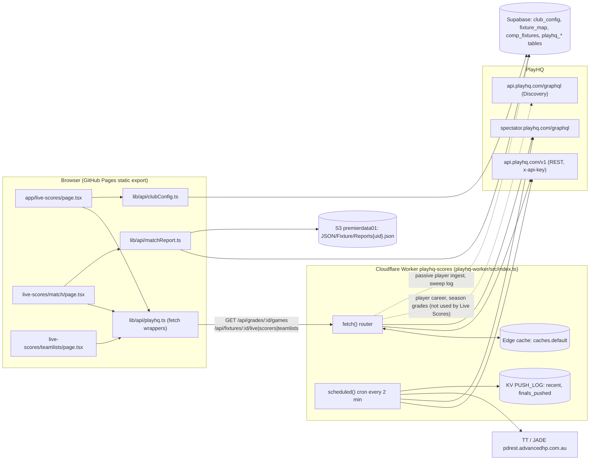

# Live Scores: data flow technical document

Audience: a developer new to the project. This document explains how the **Live Scores** page (`reporting-ui/app/live-scores/page.tsx`) gets its fixtures, scores, team lists and goal kickers from our own API, the Cloudflare Worker in `playhq-worker/`.

Everything below was checked against the code on `main` at the time of writing. Line numbers are approximate (they drift as files change); search for the function name. Anything I could not confirm from code alone is listed in [section 7](#7-known-gotchas-and-open-questions).

Location note: this file lives in `reporting-ui/docs/` because that is where the repo's existing markdown docs are (`ARCHITECTURE.md`, `jade-competition-map.md`). The root `docs/` folder only holds `reference/club-logos-source.xlsx`.

## Table of contents

1. [Overview and architecture](#1-overview-and-architecture)
2. [Endpoint catalogue](#2-endpoint-catalogue)
3. [Data model](#3-data-model)
4. [Data flow per feature](#4-data-flow-per-feature)
5. [Worker internals](#5-worker-internals)
6. [Run, test, deploy, and curl examples](#6-run-test-deploy-and-curl-examples)
7. [Known gotchas and open questions](#7-known-gotchas-and-open-questions)
8. [Glossary and "where to change what"](#8-glossary-and-where-to-change-what)

---

## 1. Overview and architecture

The browser never talks to PlayHQ. It calls the Worker (`playhq-scores`), which holds the PlayHQ REST API key, calls PlayHQ server-side, normalises the result and caches it in the Cloudflare edge cache.

What the Live Scores page actually uses:

| Need | Source | Via |
| --- | --- | --- |
| Fixtures (whole season of a grade), final scores, statuses | PlayHQ official REST `GET /v1/grades/{id}/games` | Worker `GET /api/grades/:gradeId/games` |
| In-play score and clock | PlayHQ spectator GraphQL (`spectator.playhq.com/graphql`, op `game`) | Worker `GET /api/fixtures/:id/live` |
| Complete goal kickers and quarter scores | PlayHQ official REST `GET /v1/games/{id}/summary` | Worker `GET /api/fixtures/:id/scorers` |
| Team lists | REST game summary (`appearances[]`), falling back to the spectator feed | Worker `GET /api/fixtures/:id/teamlists` |
| Club logos / colours | Supabase table `club_config` | `supabase-js` directly from the browser (not the Worker) |
| "Statistics" page (match report) | Public S3 JSON `Reports{uid}.json` plus Supabase `fixture_map` / `comp_fixtures` | Browser directly (not the Worker) |

Not present on the Live Scores page, despite what you may expect: **no ladder/standings, no cards, no event timeline from PlayHQ, no custom React hooks**. There is no ladder route in the Worker either (`grep -i ladder playhq-worker/src/index.ts` returns nothing). See section 7.

### Diagram



### Front-end configuration

| Name | Where set | Purpose |
| --- | --- | --- |
| `NEXT_PUBLIC_PLAYHQ_WORKER_URL` | `reporting-ui/.env.local` for local dev; GitHub Actions repo **variable** of the same name (or default) for deploys (`.github/workflows/deploy.yml`, Build step) | Worker base URL. Trailing `/` is stripped. |
| default if unset | `lib/api/playhq.ts` line ~11 (`WORKER_BASE`) | `https://playhq-scores.premier-data-enterprise.workers.dev` |
| `NEXT_PUBLIC_SUPABASE_URL`, `NEXT_PUBLIC_SUPABASE_ANON_KEY` | `.env.local`; GitHub Actions secrets of the same names | Used by `lib/supabase.ts` for `club_config`, `fixture_map`, `comp_fixtures` |

Authentication from browser to Worker: **none**. The page sends no `Authorization` header and no custom request headers (`fetch(url, { cache: "no-store", signal })`). Access control is not enforced on the read routes. CORS is controlled by the Worker var `ALLOWED_ORIGINS` (currently `"*"` in `wrangler.toml`).

Because `NEXT_PUBLIC_*` values are inlined at build time (static export), changing the Worker URL requires a rebuild and redeploy of the front end.

Secrets live only on the Worker side (names only here, never values):

| Name | Kind | Set with |
| --- | --- | --- |
| `PHQ_API_KEY` | secret | `npx wrangler secret put PHQ_API_KEY` |
| `BACKFILL_TOKEN` | secret (gates `/api/admin/*`, not used by Live Scores) | `npx wrangler secret put BACKFILL_TOKEN` |
| `PHQ_TENANT`, `CACHE_TTL_SECONDS`, `LIVE_TTL_SECONDS`, `KNOWN_GRADE_IDS`, `ALLOWED_ORIGINS`, `TT_BASE_URL`, `R2_PAGES_PER_TICK`, `COMPETITOR_POLL_MINUTES`, `SUPABASE_URL`, `SUPABASE_ANON_KEY` | plain vars in `playhq-worker/wrangler.toml` `[vars]` | edit file, redeploy |

`wrangler.toml` contains `SUPABASE_ANON_KEY` as a committed plain var (a JWT with role `anon`; the file comments say it is public in the static site anyway). It is not reproduced here.

---

## 2. Endpoint catalogue

Base URL: `<WORKER_URL>`, for example `https://playhq-scores.<account>.workers.dev`. All routes are `GET` unless noted. Routing is a chain of `if (url.pathname ...)` / regex checks inside `export default { fetch }` (`playhq-worker/src/index.ts`, from line ~3003). `OPTIONS` returns 204 with CORS headers. Any non-GET reaching the generic section returns `405 {"error":"method_not_allowed"}` (guard just before `/health`, ~line 3308). Unknown paths return `404 {"error":"not_found"}`.

### 2.1 Endpoints the Live Scores page calls

| # | Route | Called from | Front-end function | Used when |
| --- | --- | --- | --- | --- |
| A | `GET /api/grades/:gradeId/games` | `page.tsx` `load()`; `match/page.tsx`; `teamlists/page.tsx` | `getGradeGames()` (`playhq.ts` ~94) | Page load, competition change, Refresh, every poll |
| B | `GET /api/fixtures/:id/live` | `page.tsx` `load()` and the scorers effect | `getLiveScore()` (~168) | In-play candidates; fallback when `/scorers` fails |
| C | `GET /api/fixtures/:id/scorers` | `page.tsx` scorers effect | `getScorers()` (~222) | Visible FINAL or LIVE games |
| D | `GET /api/fixtures/:id/teamlists` | `teamlists/page.tsx` | `getTeamLists()` (~204) | Team Lists page only |

`:id` is the full PlayHQ game UUID (`game.id` from route A). Grade id is a UUID from `LIVE_SCORE_GRADES` in `playhq.ts`.

### 2.2 Endpoints defined in `playhq.ts` but NOT called by the Live Scores page

| Route | Front-end function | Actually used by |
| --- | --- | --- |
| `GET /api/fixtures/:id/status` | `getLiveStatus()` (~120) | Nothing in the page (comment says "future per-game drill-down") |
| `GET /api/push-log` | `getPushLog()` (~253) | `app/push-log/page.tsx` |
| `GET /api/round-summary` | `getRoundSummary()` (~296) | `app/push-log/page.tsx` |

### 2.3 Worker routes the page does not use (for completeness)

| Route | Purpose |
| --- | --- |
| `GET /health` | `{"ok":true}` |
| `GET /api/fixtures/:id/live-scores` | Raw spectator `game` object |
| `GET /api/grades/:gradeId/fixtures` | Lean fixture index (`toFixtureLite`) for external consumers |
| `GET /api/competition/:seasonId/grades` | Season grades via Discovery GraphQL (query `gradeListDiscoverSeason`) |
| `GET /api/player/:playerId/profile` | Player career via Discovery GraphQL (`publicProfileStatistics`) |
| `GET /api/sweep-log`, `GET /api/sweep-log/teams?season=` | Player sweep progress read from Supabase |
| `GET /api/push/:id`, `GET /api/push`, `GET /api/push-finals`, `GET /api/collect-competitors` | Manual triggers of cron work (see gotcha on no auth) |
| `GET/POST /api/admin/backfill-players`, `GET/POST /api/admin/sweep-competition` | Token-gated (`BACKFILL_TOKEN`) player backfill and competition sweep |
| `POST /api/r2-report` | Admin R2 storage report (separate feature, `src/r2Report.ts`) |

### 2.4 Common behaviour

* **Request headers from the page:** none custom. Worker CORS response: `Access-Control-Allow-Origin` (from `ALLOWED_ORIGINS`), `Allow-Methods: GET, POST, OPTIONS`, `Allow-Headers: Content-Type`, `Vary: Origin` (`corsHeaders`, ~464).
* **Auth:** none on these routes.
* **ID validation:** grade id must match `UUID_RE` (else `400 {"error":"invalid_grade_id"}`). Fixture id must match `ID_RE = /^[a-zA-Z0-9_-]{4,64}$/` (else `400 {"error":"invalid_fixture_id"}`). So both the short 8-char id and the full UUID pass validation.
* **Cache response headers:** `X-Cache: HIT|MISS`. On MISS also `Cache-Control: public, max-age=<ttl>`. On HIT no `Cache-Control` is set (the Worker rebuilds the Response from the cached body).
* **Error body:** `{"error": "<code>"}` with CORS headers. Error responses are never cached.
* **Upstream error mapping** (`UpstreamError`, `fetchGradeGames` / `fetchGameSummary` / `fetchGame`):

| Condition | Worker status | `error` code |
| --- | --- | --- |
| `PHQ_API_KEY` missing | 500 | `api_key_not_configured` |
| PlayHQ 429 | 429 (+ `Retry-After: 120`) | `rate_limited` |
| PlayHQ 401/403 on REST | same status | `forbidden` |
| PlayHQ 403 on spectator | 403 | `forbidden` |
| PlayHQ 404 / game missing | 404 | `not_found` |
| other non-OK, or GraphQL `errors` | 502 | `upstream_error` / `graphql_errors` |
| timeout or network fault | 502 | route-specific, e.g. `unable_to_retrieve_scores`, `unable_to_retrieve_games`, `unable_to_retrieve_scorers`, `unable_to_retrieve_team_lists` |

Upstream timeouts: 12 s for REST (`AbortSignal.timeout(12_000)`), 10 s for spectator (`fetchGame`).

### 2.5 A. `GET /api/grades/:gradeId/games`

Handler: `gradeMatch` block (~line 3386). Returns every game of the grade for the whole season. `fetchGradeGames` (~1231) calls `GET https://api.playhq.com/v1/grades/{gradeId}/games` with headers `x-api-key`, `x-phq-tenant` (default `afl`), `Accept: application/json`, following `metadata.hasMore` / `metadata.nextCursor` (cursor query param) up to 50 pages.

* Query params: none.
* Cache: edge cache key `https://playhq-cache/grade-games/{gradeId}`, TTL `min(CACHE_TTL_SECONDS, 60)` = **60 s**. `X-Cache` shows HIT/MISS.
* Response (PlayHQ game objects passed through unchanged, wrapped):

```json
{
  "gradeId": "<grade-uuid>",
  "count": 1,
  "data": [
    {
      "id": "<game-uuid>",
      "status": "FINAL",
      "url": "https://www.playhq.com/afl/org/<org>/<comp>/<grade-slug>/game-centre/<game-uuid>",
      "createdAt": "...", "updatedAt": "...",
      "round": { "id": "...", "name": "Round 1", "abbreviatedName": "R1", "isFinalRound": false },
      "pool": null,
      "schedule": { "date": "2026-10-02", "time": "20:00:00", "timezone": "Australia/Darwin" },
      "competitors": [
        { "id": "<team-uuid>", "name": "Team A Men Premier", "isHomeTeam": true, "outcome": "WON",
          "scoreTotal": 85,
          "scoreSubTotal": [ { "type": "TOTAL_GOALS", "value": 12 }, { "type": "TOTAL_BEHINDS", "value": 13 } ] },
        { "id": "<team-uuid>", "name": "Team B Men Premier", "isHomeTeam": false, "outcome": "LOST", "scoreTotal": 60, "scoreSubTotal": [] }
      ],
      "venue": { "id": "...", "name": "TIO Stadium", "surfaceName": "...", "address": { "suburb": "...", "state": "NT" } }
    }
  ]
}
```

(Shape taken from the TypeScript types in `playhq.ts`; values are illustrative. The Worker does not transform `data`.)

Errors: 400 invalid grade, plus the table in 2.4.

### 2.6 B. `GET /api/fixtures/:id/live`

Handler: the final `fixtures/:id/(live-scores|live|status)` block (~4080). Calls spectator GraphQL `game` (`GAME_QUERY`, ~233) as `POST https://spectator.playhq.com/graphql` with headers `Content-Type: application/json`, `Origin: https://www.playhq.com`, `Accept: */*`, `x-phq-tenant` and variables `{ id, scope: "BY_PERIOD" }`. No API key is needed for this call. For `kind === "live"` the Worker also calls `resolveGameTeams()` to attach team id and name, because the spectator feed carries no team identity.

* Cache: key `https://playhq-cache/live/{id}`, TTL `LIVE_TTL_SECONDS` (**15 s** in `wrangler.toml`; code default also 15).
* Response `NormalisedLive` (`normaliseLive`, ~710):

```json
{
  "id": "<id exactly as requested>",
  "status": "IN_PROGRESS",
  "clock": { "period": "3rd Quarter", "time": "02:11", "status": "RUNNING" },
  "home": {
    "id": "<team-uuid or null>", "name": "Team A Men Premier or null",
    "total": 45, "goals": 6, "behinds": 9,
    "scorers": [ { "name": "A Player", "number": "12", "goals": 3, "behinds": 1 } ],
    "periods": [ { "period": "Q1", "label": "First Quarter", "goals": 2, "behinds": 3, "total": 15 } ]
  },
  "away": { "...": "same shape" }
}
```

The `clock.status` values are not enumerated in the code (open question). `total`, `goals`, `behinds` are `null` when the feed has no stat for them. `home.id`/`name` are `null` when the game cannot be found in the `KNOWN_GRADE_IDS` grade feeds, or `PHQ_API_KEY` is unset (`resolveFullGame` returns null).

### 2.7 C. `GET /api/fixtures/:id/scorers`

Handler: `scorersMatch` (~3590). Steps: `resolveFullGame(id)` finds the full game in the known grades' (cached) feeds, `fetchGameSummary(fullId)` calls `GET https://api.playhq.com/v1/games/{fullId}/summary`, `summaryToScorersPeriods()` (~1300) normalises, and `ctx.waitUntil(ingestPlayers(summary, env))` passively upserts players into Supabase after the response.

* Cache: key `https://playhq-cache/scorers/{id}`, TTL `LIVE_TTL_SECONDS` (15 s).
* Response: same `NormalisedLive` shape as B, with `clock` always `{period:null,time:null,status:null}`, and `status` taken from the summary.
* Scorers: from `appearances[]`: `goals = floor(scoreSubTotal["6_POINT_SCORE"] / 6)`, `behinds = scoreSubTotal["1_POINT_SCORE"]`; sorted by goals then behinds descending.
* Periods: from `summary.periods[]` (`FIRST_QTR`..`FOURTH_QTR` mapped to Q1..Q4). See gotcha on the period `goals` calculation.
* Errors: `404 {"error":"not_found"}` if the game is not in any `KNOWN_GRADE_IDS` grade, or the summary is not found; others per 2.4.

### 2.8 D. `GET /api/fixtures/:id/teamlists`

Handler: `teamlistsMatch` (~3648).

1. Try REST summary: `summaryToTeamLists()` (~1430). Every `appearances[]` entry (grouped by `teamID`) is a selected player. Returns `null` when there are zero appearances.
2. If that throws or returns `null`, fall back to the spectator feed: `fetchGame()` plus `teamListFrom()` (~654) over `statistics.{home,away}.players[]`.
3. Both sides are sorted by jumper number ascending (non-numeric last), then name.

* Cache: key `https://playhq-cache/teamlists/{id}`, TTL 15 s.
* Response:

```json
{
  "id": "<id as requested>",
  "status": "UPCOMING",
  "home": { "id": "<team-uuid>", "name": "Team A", "players": [ { "id": "<player-uuid or null>", "name": "First Last", "number": "7", "position": "..." } ] },
  "away": { "id": "...", "name": "...", "players": [] }
}
```

Spectator fallback players have `id: null` and `position: null`. If both sources have nothing, the Worker returns HTTP 200 with empty `players` arrays (not an error).

### 2.9 Other front-end data sources used by the Live Scores area (not the Worker)

| Source | Used for | Code |
| --- | --- | --- |
| Supabase `club_config` | Logo override URLs and club colours | `lib/api/clubConfig.ts` (`ensureClubConfigCache`, `clubLogoOverride`, `clubConfigFor`), read via `supabase.from("club_config")` |
| Supabase `fixture_map`, `comp_fixtures` | Map PlayHQ game to JADE fixture uid | `lib/api/matchReport.ts` (`resolveJadeUidForGame`), `lib/api/fixtureMap.ts` |
| S3 public JSON `https://premierdata01.s3.ap-southeast-2.amazonaws.com/JSON/Fixture/Reports{uid}.json` | Statistics page player stats and timeline | `lib/api/fixtureReports.ts` (`fixtureReportUrl`, `fetchFixtureReport`), `getMatchReport` uses `cache: "force-cache"` |
| Static files `public/clubs/*.png` | Bundled crests | `lib/api/clubLogos.ts` (`clubLogo`, `clubInitials`, `clubBadgeColor`) |

I read the Statistics page (`match/page.tsx`) only at the data-loading level (grade games, then `getMatchReportForGame`). Its stat aggregation in `matchReport.ts` is out of scope here.

---

## 3. Data model

All types are in `reporting-ui/lib/api/playhq.ts`.

### 3.1 Game (REST passthrough)

| Type | Field | Meaning |
| --- | --- | --- |
| `PlayHqGame` | `id` | Full game UUID. Used for every follow-up call and as React key |
| | `status` | See 3.2 |
| | `url` | PlayHQ game-centre link; the page shows a "PlayHQ" link when set. The Worker also derives a competition label from it |
| | `createdAt`, `updatedAt` | PlayHQ timestamps (not used by the page) |
| | `round` | `{ id, name, abbreviatedName, isFinalRound }`. `name` such as `"Round 1"`, `"Grand Final"` drives the round pills |
| | `pool` | Unused (`unknown | null`) |
| | `schedule` | `{ date: "yyyy-mm-dd", time: "HH:mm:ss", timezone }`, see 3.4 |
| | `competitors[]` | Two entries; home is the one with `isHomeTeam: true` (`sides()`, ~322) |
| | `venue` | `{ id, name, surfaceName?, address? }` or `null` ("Venue TBC") |
| `Competitor` | `outcome` | `WON` / `LOST` / `DRAW` / `null`. Used only to bold the winning side (`wonSide`) |
| | `scoreTotal` | Total points or `null` |
| | `scoreSubTotal[]` | `{type, value}`; `TOTAL_GOALS` and `TOTAL_BEHINDS` give the "G.B" label (`goalsBehinds()`, ~333) |

### 3.2 Status values and the "REST status unknown" rule

`GameStatus` is a loose union: `UPCOMING | IN_PROGRESS | FINAL | ABANDONED | POSTPONED | CANCELLED | string`. The values `LIVE` and `""`/`"NULL"` are also handled in code. There is no `LIVE` literal in the type, but `isLive()` accepts it.

| Function | Rule | Used for |
| --- | --- | --- |
| `isLive(status)` (`playhq.ts` ~342) | upper-cased equals `IN_PROGRESS` or `LIVE` | Red styling, polling, clock label |
| `restStatusUnknown(status)` (~314) | trimmed upper-cased is `""` or `"NULL"` | Selects which games get a spectator probe |
| `statusBadge()` (`page.tsx` ~120) | `IN_PROGRESS`/`LIVE` gives "LIVE"; `FINAL` gives "Final"; `UPCOMING`, `""`, `NULL` give "Upcoming"; `ABANDONED`/`CANCELLED`/`POSTPONED` give a capitalised label (amber); anything else is title-cased | Badge |
| Team Lists button | shown unless status is `ABANDONED`, `CANCELLED` or `POSTPONED` | `showTeamLists` in `GameRow` |
| Statistics button | shown only when effective status is exactly `FINAL` | `isFinalGame` in `GameRow` |

`restStatusUnknown` is a plain pre-check on the REST status. The Worker has its own copy (`restStatusUnknown`, `isSpectatorLive`, `isFinalStatus`, `isLiveCandidate`, ~1680-1715) that differs: see gotchas.

### 3.3 Live and normalised types

| Type | Fields |
| --- | --- |
| `NormalisedLive` | `id`, `status` (nullable), `clock { period, time, status }`, `home`, `away` |
| `NormalisedLiveSide` | `id`, `name`, `total`, `goals`, `behinds` (all nullable), `scorers: Scorer[]`, `periods: PeriodScore[]` |
| `Scorer` | `name`, `number` (string or null), `goals`, `behinds` |
| `PeriodScore` | `period` ("Q1"), `label` ("First Quarter"), `goals`, `behinds`, `total` (points scored in that period, not cumulative) |
| `TeamLists` / `TeamListSide` / `TeamListPlayer` | as in 2.8 |
| `LiveScore` | loose `{ id, status, updatedAt, [k]: unknown }` for `/status` |

### 3.4 Schedule, date and timezone handling

* `scheduleDate(game)` (`playhq.ts` ~348) builds `new Date(`${date}T${time || "00:00:00"}`)` with **no offset**. The browser interprets that string in the **viewer's local timezone**. `schedule.timezone` is never read by the front end.
* `scheduleLabel`, `scheduleDateLabel`, `scheduleTimeLabel` format with `toLocaleString("en-AU", ...)`.
* The Worker does the same job in `scheduledKickoffMs()` (~1668) but appends a fixed `+09:30` (`NTFL_UTC_OFFSET`, Australia/Darwin, no DST) because Workers run in UTC. Comment in code: if a grade in a DST-observing zone is added, replace this with a lookup from `schedule.timezone`.
* "Today" for default round selection uses the viewer's local date (`toLocaleDateString("en-CA")`).
* Missing `schedule.date` gives "TBC" and excludes the game from live windows.

### 3.5 Rounds: naming, ordering and "latest round"

On the Live Scores page itself (`page.tsx`):

* **Pills**: unique `game.round.name` values sorted by `roundOrder()` (~93): numbered rounds by number (1 to 99); `Finals Round/Week N`, `FWn`, `Fn`, Qualifying/Elimination: `1000 + n`; Semi `2000`; Preliminary `3000`; Grand `4000`; unrecognised `9999`.
* **Pill label**: `roundShort()` (~70): `GF`, `PF`, `SF`, `QF`, `EF`, `F<n>`, or the zero-padded number (`Round 2` becomes `02`).
* **Default selected round** (effect after `rounds`, ~line 764): (1) a round with a live game (REST `isLive` or a spectator overlay), (2) else a round with a game scheduled on the viewer's local date, (3) else the round whose nearest game is closest in time to now. This runs once per data load (`didDefaultRound` latch, reset on competition change).
* Games within a round are sorted by kickoff time.

`lib/round-summary/roundSummary.ts` is **not imported by the Live Scores page**. It is the tested reference for the "latest round" rule used by the Push Activity board; the Worker keeps a copy inline (`selectLatestRound`, ~1846). Rule: among rounds with a dated game, (A) the highest round whose earliest kickoff has passed; else (B) the highest round starting within 6 h (`ROUND_LOOKAHEAD_MS`); else (C) the lowest-numbered upcoming round; else (D) highest round by name. Numbered rounds sort before unnumbered ones. The code comment says the two copies must be kept in sync by hand. Their `shortRound` output differs from the page's `roundShort` (`R3` versus `03`).

### 3.6 How live overlays merge onto REST data (`GameRow`, `page.tsx` ~299-420)

Inputs per row: `game` (REST), `live` prop (`liveById[id] ?? scorersById[id]`), `scorersData` (`scorersById[id]`).

| Display item | Precedence |
| --- | --- |
| Effective status | `liveData?.status ?? game.status` (`liveData` here may be the spectator overlay or the REST-summary scorers payload) |
| Score per side | `game.competitors[].scoreTotal ?? liveData.<side>.total ?? null`. REST wins when present, because the spectator total can be null |
| G.B text | REST `TOTAL_GOALS`/`TOTAL_BEHINDS` string, else `liveData` goals/behinds (`0` default) |
| Score visible? | at least one score non-null and effective status is not `UPCOMING` |
| Clock label ("Q3 02:11") | only if live and `liveData.clock` exists; `shortPeriod()` turns "3rd Quarter" into "Q3" |
| Extended scores and goal kickers | `scorersData ?? liveData` (REST summary preferred). Sections are hidden when there are no periods or scorers |

---

## 4. Data flow per feature

Constants in `page.tsx`: `LIVE_POLL_MS = 120_000` (line 58), `WINDOW_BEFORE = 30 min`, `WINDOW_AFTER = 4 h` (inside `load()`, ~694), `CONCURRENCY = 3` for scorers fetches (~847), `SEASONS = ["2026"]` (line 63).

### 4.1 Initial page load

1. `LiveScoresPage` mounts with `comp = "ntfl-mens"`, `loading = true`.
2. Effect: `ensureClubConfigCache()` (Supabase `club_config`) primes logo overrides; on success it bumps a tick so crests re-render. Failure is ignored.
3. Effect on `load` identity (changes with `grade.gradeId`): resets state (`games`, `liveById`, `scorersById`, `roundFilter = "all"`, round-default latch) and calls `load()`.
4. `load()` calls `getGradeGames(gradeId)` (route A, `cache: "no-store"` on the browser side), then `setGames`, `setError(null)`, `setLastUpdated`.
5. Still inside `load()`: pick **live candidates**: games where `restStatusUnknown(status)` is true, with a parseable schedule, and `now` in `[kickoff - 30 min, kickoff + 4 h]` (kickoff = `scheduleDate()`, viewer-local).
6. `Promise.allSettled(candidates.map(getLiveScore))` (route B). Only fulfilled results whose `status` passes `isLive()` become overlays in `liveById`.
7. `finally`: `loading = false`.
8. Round default effect picks the initial round pill (3.5).
9. Scorers effect (4.4) runs for the visible round.

### 4.2 Selecting competition, round or season

* **Competition dropdown** (`LIVE_SCORE_GRADES`, 5 hardcoded grades: NTFL Men's, NTFL Women's, EFNL Premier, GVL Seniors, PFL A-Grade): changes `comp`, which changes `grade` and therefore `load`, which triggers the reset-and-reload in 4.1. Previous in-flight requests are not aborted (no `AbortController` is passed from the page).
* **Round pill**: sets `roundFilter` only; filtering is client-side over `games`. No network call, except the scorers effect re-evaluates for the new visible set.
* **Season dropdown**: only one option (`2026`). `setSeason` changes local state and nothing else; it does not change what is fetched.

### 4.3 Polling and refresh

* Manual Refresh button: `load(true)`, sets `refreshing` (spinner), same steps as 4.1 without clearing state.
* Auto poll: `anyLive = Object.keys(liveById).length > 0`. Only while `anyLive` is true, a `setInterval` calls `load(true)` every 120 s. When no overlays exist, the interval is cleared. A `liveRef` stops a stale interval tick firing after live ends.
* Consequence: auto-poll starts only once a first `load()` has found at least one overlay. If no game is in the candidate window at load time, the page does not poll at all (user can press Refresh).
* Each poll re-runs the full flow: grade games, then one `/live` per candidate. Effective load on the Worker per viewer per cycle: 1 grade-games read (60 s edge cache) plus N live reads (15 s edge cache).
* Every poll replaces `liveById` entirely (`setLiveById(overlays)`), so a game that stops being a candidate or stops being live drops out of the overlay.

### 4.4 Goal kickers and quarter scores

Effect keyed on `[visible, liveById]` (~line 828):

1. `needed` = visible games that either have a live overlay (always refetched on every effect run) or are `FINAL` per REST status and not yet in `scorersById`.
2. A pool of 3 workers calls `getScorers(id)` (route C). If that throws, it falls back to `getLiveScore(id)` (route B).
3. A result is stored in `scorersById[id]` only if it has scorers on either side or home periods; otherwise it is not stored, so it is retried on the next effect run (round switch or poll).
4. Failures for a single game are swallowed.
5. A cancellation flag prevents state updates after unmount/re-run.

The UI shows two collapsed sections per card: "Extended Scores" (`QuarterTable`) and "Goal kickers" (`ScorerList` with a Home/Away toggle). Both stay collapsed by default.

### 4.5 Team lists

* Button on each card (not for abandoned/cancelled/postponed) navigates to `/live-scores/teamlists?grade=<key>&id=<gameId>`.
* `teamlists/page.tsx` effect: `Promise.all([getGradeGames(gradeId), getTeamLists(gameId)])` (routes A and D), finds the game by id for the header, then `clubConfigFor()` for each team for number-badge colours and logo (Supabase `club_config`).
* Errors: "This match link is missing or invalid.", "Match not found.", or the thrown message ("Failed loading team lists (HTTP <n>)").

### 4.6 Statistics page (FINAL games only)

`match/page.tsx`: `getGradeGames()`, then `getMatchReportForGame(game)`: `resolveJadeUidForGame` (Supabase `fixture_map` first, otherwise automatic match against `comp_fixtures` by team names, round and year), then `getMatchReport(uid)` fetches the S3 JSON. If no uid is found: "No detailed report is available for this match yet. Reports appear once a game has been coded."

### 4.7 Ladder

Not implemented on this page and no Worker route exists. Nothing to document beyond that.

### 4.8 Error handling, retries, empty and loading states

| Situation | Behaviour |
| --- | --- |
| `getGradeGames` non-2xx | throws `Failed loading fixtures (HTTP <status>)`; page shows a red banner |
| Failed **refresh/poll** after a successful load | `error` is set, and the render chain is `loading ? spinner : error ? banner : ...`, so the banner **replaces the whole list** until the next successful load, although `games` state is still held |
| `getLiveScore` failure for one game | ignored (`allSettled`), no overlay for that game |
| `getScorers` failure | falls back to `/live`, then ignored |
| 429 / `Retry-After` | the front end does not read `Retry-After`, does not back off and does not retry; polls continue at 120 s |
| Loading | `Loader2` spinner with "Loading fixtures…" (only first load or competition change) |
| Empty | "No fixtures to show." (dashed box) |
| Missing team | "TBC"; missing venue "Venue TBC"; missing date "TBC" |

Worker side retry: only the Discovery GraphQL calls (`discoverFetchWithRetry`, ~875) retry on 403/429: up to 4 attempts, base 500 ms exponential with +/-20 % jitter. The REST and spectator calls the Live Scores page depends on have **no retry**.

### 4.9 Client-side caches

| Cache | Scope | Invalidated |
| --- | --- | --- |
| React state (`games`, `liveById`, `scorersById`) | Page instance | Competition change clears all; `scorersById` for FINAL games persists until then |
| `clubConfig` module cache (`cache` promise in `clubConfig.ts`, ~145) | Whole tab session | `invalidateClubConfigCache()` on admin edits; reset on load failure so it retries |
| Browser fetch cache | none for Worker calls (`cache: "no-store"`) | n/a |
| S3 match report | `cache: "force-cache"` in `getMatchReport` | Hard reload / cache clear |

---

## 5. Worker internals

All in `playhq-worker/src/index.ts` (~4230 lines, single file) plus `src/r2Report.ts` (R2 admin report, unrelated).

### 5.1 Routing and CORS

`export default { fetch, scheduled }` (~3003). Order matters: `OPTIONS`, then POST-capable admin routes (`/api/r2-report`, `/api/admin/*`), then the "GET only" guard, then `/health`, `/api/grades/:id/fixtures`, `/api/grades/:id/games`, `/api/competition/:id/grades`, `/api/sweep-log`, `/api/sweep-log/teams`, `/api/player/:id/profile`, `/api/fixtures/:id/scorers`, `/api/fixtures/:id/teamlists`, `/api/push/:id`, `/api/push`, `/api/push-finals`, `/api/collect-competitors`, `/api/push-log`, `/api/round-summary`, and finally the regex `/api/fixtures/:id/(live-scores|live|status)`.

### 5.2 Upstream calls

| Call | Endpoint | Headers | Function |
| --- | --- | --- | --- |
| Grade games | `GET https://api.playhq.com/v1/grades/{gradeId}/games` (cursor paginated) | `x-api-key` (secret `PHQ_API_KEY`), `x-phq-tenant`, `Accept` | `fetchGradeGames` ~1231 |
| Game summary | `GET https://api.playhq.com/v1/games/{fullId}/summary` | same | `fetchGameSummary` ~1271 |
| Spectator game | `POST https://spectator.playhq.com/graphql` op `game` (`GAME_QUERY`), variables `{id, scope:"BY_PERIOD"}` | `Origin: https://www.playhq.com`, `x-phq-tenant` | `fetchGame` ~755 |
| Discovery (career, season grades, sweep) | `POST https://api.playhq.com/graphql` ops `publicProfileStatistics`, `gradeListDiscoverSeason`, `gradeGames`, `gameStats` | browser `User-Agent`, lowercase `tenant: <tenant>` | `fetchPlayerCareer` ~791, `fetchSeasonGrades` ~896, `fetchGradeGameIds` ~1047, `fetchGameAppearancesSummary` ~1116 |

The Worker's own comment states the Discovery endpoint needs a browser-like User-Agent plus a lowercase `tenant` header or it returns 403 or "tenant header is missing". I did not verify that against PlayHQ.

The Live Scores page does not trigger the Discovery calls.

### 5.3 Resolving ids: `resolveFullGame`

Spectator ids are short (first segment of the UUID, e.g. `7faaae3d`). Routes B, C, D accept either. `resolveFullGame(id)` (~592) loops over `KNOWN_GRADE_IDS` (vars; falls back to `DEFAULT_GRADE_IDS`, ~67), reads each grade's games from the same edge-cache entry route A writes (`grade-games/{gradeId}`), or calls `fetchGradeGames` on a miss, and matches `full === id || full.split("-")[0] === id`. **A game in a grade that is not in `KNOWN_GRADE_IDS` is never found**: `/scorers` returns 404, `/teamlists` falls back to the spectator feed, `/live` returns null team names. `wrangler.toml` currently lists the same 5 grade ids as `LIVE_SCORE_GRADES`.

### 5.4 Caching

Two storage systems, easy to confuse:

| System | Used for | Keys / TTL |
| --- | --- | --- |
| Cloudflare Cache API (`caches.default`, "edge cache") | Every read route above | Synthetic request URLs on host `playhq-cache`: `grade-games/{gradeId}` 60 s; `grade-fixtures/{gradeId}` 60 s; `live/{id}`, `live-scores/{id}` 15 s; `status/{id}` 90 s; `scorers/{id}` 15 s; `teamlists/{id}` 15 s; `round-summary` 45 s; `competition-grades/{seasonId}/{tenant}` 120 s; `player-career/{id}/{tenant}` 300 s |
| Workers KV, binding `PUSH_LOG` (the only KV namespace) | TT push log | key `recent`: newest-first ring buffer of at most 100 entries (`PUSH_LOG_MAX`); key `finals_pushed`: map of fixture id to ISO time, capped at 500, guarantees a FINAL is pushed once |

No KV key is read on the Live Scores request path. (The Cache API is per data centre in Cloudflare's model; that is general Cloudflare behaviour, not shown in this repo.)

TTL knobs: `CACHE_TTL_SECONDS` (90) and `LIVE_TTL_SECONDS` (15) in `wrangler.toml`.

### 5.5 Normalisation

* Spectator to `NormalisedLive`: `normaliseLive` (~710). Score from `result.{home,away}.statistics[]` types `TOTAL_SCORE`, `TOTAL_GOALS`, `TOTAL_BEHINDS`; clock from `clock.{period,time,status}`; scorers from `statistics.{home,away}.players[]` where goals or behinds > 0; periods from `result.{side}.periods[]`.
* REST summary to `NormalisedLive`: `summaryToScorersPeriods` (~1300). Sides by `competitors[].isHomeTeam`; players by `appearances[].teamID`.
* Grade games: passed through untouched (only wrapped with `gradeId` and `count`).

### 5.6 Rate limits and resilience

* Pass-through of upstream 429/403 with `Retry-After: 120` on 429.
* Edge cache collapses concurrent viewers to roughly one upstream call per key per TTL.
* `mapPool(items, limit, fn)` (~1722) bounds concurrency and never rejects (used by the cron probes: limit 4; round-summary: limit 6).
* Sweeps (`runSweepBatch` ~2512, `runBackfillBatch` ~2459) are token-gated, resumable batches (hard cap 12 games per call) for the free-plan subrequest limit (~50). They return `throttled` / `retryable` / `retryAfterMs` for the caller to retry at the same offset. Progress is stored in Supabase `playhq_sweep_log` (`updateSweepLog` ~2624). Not part of the Live Scores request path.
* Passive ingest (`ingestPlayers` ~2391) from `/scorers` and `/teamlists` summaries into Supabase `playhq_players` and `playhq_player_appearances` runs in `ctx.waitUntil`, errors swallowed, so it never delays or alters the response.

### 5.7 Scheduled work (`scheduled()`, ~4173)

`wrangler.toml`: `crons = ["*/2 * * * *"]` (every 2 minutes). Each tick:

1. `liveFixtureIds()` (~2007): across `KNOWN_GRADE_IDS`, fixtures REST already reports live, plus spectator probes (pool of 4) of "candidates" (REST status unknown or `UPCOMING`, within 30 min before to 4 h after kickoff using `scheduledKickoffMs`). For each live fixture `pushFixtureToTT()` (~1920) pushes score (`POST {TT_BASE_URL}/PlayHQScoreUpdate`) and team list (`/PlayHQTeamUpdate`) to the TT/JADE system and records to the KV push log.
2. `r2ScanTick()`: advances the R2 report scan.
3. `pushFinals()` (~2141): once per recently FINAL fixture (kickoff within 6 h, `FINAL_WINDOW_AFTER_MS`), guarded by KV `finals_pushed`.
4. Every `COMPETITOR_POLL_MINUTES` (30) on matching minutes: competitor RSS/YouTube collector into Supabase.

Relevance to Live Scores: the cron does not feed the page. It reuses the same edge-cached grade feeds, spectator feed and normalisers, and its push log feeds `/push-log`. `chooseLive()` prefers the spectator score if it carries any numeric value and otherwise uses the summary score.

---

## 6. Run, test, deploy, and curl examples

### 6.1 Front end (`reporting-ui`)

```bash
cd reporting-ui
npm install
# .env.local (git-ignored): NEXT_PUBLIC_PLAYHQ_WORKER_URL, NEXT_PUBLIC_SUPABASE_URL, NEXT_PUBLIC_SUPABASE_ANON_KEY
npm run dev      # next dev
npm run build    # next build; next.config.js has output: "export", so static files go to out/
npm test         # vitest --run (includes lib/round-summary/roundSummary.test.ts)
npm run lint
```

`AGENTS.md` in `reporting-ui` warns that this Next.js version has breaking changes; read `node_modules/next/dist/docs/` before changing framework-level code.

Deploy: pushing to `main` runs `.github/workflows/deploy.yml` ("Deploy Next.js to GitHub Pages"): Node 22, `npm ci`, `npm run build` in `reporting-ui` with the Supabase secrets and `NEXT_PUBLIC_PLAYHQ_WORKER_URL`, then uploads `reporting-ui/out` to Pages. There are other workflows in `.github/workflows/` (`nextjs.yml`, `auto-merge.yml`, `sync.yml`); I did not review them. `npm run deploy` (`gh-pages -d out`) also exists in `package.json`.

### 6.2 Worker (`playhq-worker`)

```bash
cd playhq-worker
npm install
npx wrangler login            # first time
# local secrets: playhq-worker/.dev.vars (git-ignored), e.g. PHQ_API_KEY=<your-key>
npm run dev                   # wrangler dev -> http://localhost:8787
npm run typecheck             # tsc --noEmit
npx wrangler secret put PHQ_API_KEY        # prompts for the value
npx wrangler secret put BACKFILL_TOKEN     # admin routes only
npx wrangler deploy           # manual deploy (also: npm run deploy)
npx wrangler tail             # live logs (cron pushes log here)
```

Deploys are manual; nothing in CI deploys the Worker. The Worker has no automated tests. To point the front end at a local Worker set `NEXT_PUBLIC_PLAYHQ_WORKER_URL=http://localhost:8787` in `reporting-ui/.env.local`. Cron does not fire under plain `wrangler dev` unless you use its scheduled testing option (not verified here).

### 6.3 curl examples

```bash
W="<WORKER_URL>"                 # e.g. https://playhq-scores.<account>.workers.dev
GRADE="<grade-uuid>"             # e.g. a value from LIVE_SCORE_GRADES in lib/api/playhq.ts
GAME="<game-uuid-or-short-id>"   # game.id from the grades response

curl -i "$W/health"
curl -i "$W/api/grades/$GRADE/games"            # check X-Cache header, run twice
curl -i "$W/api/grades/$GRADE/fixtures"         # lean list
curl -i "$W/api/fixtures/$GAME/live"
curl -i "$W/api/fixtures/$GAME/live-scores"     # raw spectator payload
curl -i "$W/api/fixtures/$GAME/status"
curl -i "$W/api/fixtures/$GAME/scorers"
curl -i "$W/api/fixtures/$GAME/teamlists"
curl -i "$W/api/push-log"
curl -i "$W/api/round-summary"
# Admin (token from your secret store; never commit):
curl -i -H "Authorization: Bearer <BACKFILL_TOKEN>" "$W/api/admin/backfill-players?grade=$GRADE&offset=0&limit=10"
```

No auth header is needed for the read routes. Do not call `/api/push`, `/api/push/:id` or `/api/push-finals` casually: they send data to the production TT system.

---

## 7. Known gotchas and open questions

Items marked **(unconfirmed)** could not be settled from the code and need a runtime check.

### Correctness and consistency

1. **Live detection for `UPCOMING` games differs between front end and Worker.** The page only probes the spectator feed when REST status is `""` or `"NULL"` (`restStatusUnknown`). The Worker's own comments say the NTFL REST feed stays `UPCOMING` right up to `FINAL`, so its `isLiveCandidate` also accepts `UPCOMING`. If REST really reports `UPCOMING` during play, the Live Scores page would never create an overlay for those games (so no live score and no auto-poll), while the cron would still push them. The comment above `restStatusUnknown` in `playhq.ts` says that in AFL an empty/null status means "about to start or in play". **(unconfirmed which status PlayHQ returns in play)**; the discrepancy itself is in code.
2. **Windows are computed in different timezones.** Front end: viewer-local. Worker: fixed `+09:30` (Darwin). A viewer outside UTC+09:30 gets a shifted 30 min / 4 h window. Both ignore `schedule.timezone`, so any grade outside Darwin (EFNL, GVL, PFL are Victorian, which observes DST, if their `schedule.time` is local to the venue) would be off in the Worker's windows. The Worker comment itself flags this. **(unconfirmed which timezone each grade's `schedule.time` is in)**
3. **Period goals in `/scorers` look inconsistent.** `periodsFor()` in `summaryToScorersPeriods` (~1380) sets `goals = subVal(sub, "6_POINT_SCORE")` (no division by 6), whereas goal kickers use `floor(6_POINT_SCORE / 6)`. If `6_POINT_SCORE` is points (as the kicker logic assumes), the quarter table would show e.g. `18.4` for 3 goals 4 behinds. **(unconfirmed against a real response)**
4. **`/live` is called with the full game UUID by the page**, but the Worker code elsewhere describes the spectator `game(id)` query as taking the short id (the cron probes with `shortId`, and `pushFixtureToTT` receives full ids from `liveFixtureIds` yet passes them to `fetchGame`, wrapped in try/catch with a fallback). Whether PlayHQ's spectator API accepts the full UUID is **unconfirmed** from code. Also, edge cache keys use the id string as passed, so short and full ids cache separately.
5. **Team lists pre-match.** `page.tsx` says squads are published pre-match and shows the button for UPCOMING games. `playhq.ts` says "PlayHQ has no pre-game lineup" and `teamListFrom` says the spectator list is empty pre-game. When both are empty the Worker returns 200 with empty arrays, which the team list page presumably renders as empty. **(unconfirmed which is true)**
6. **A failed poll hides the list** (4.8). The retained `games` are not shown while `error` is set.
7. **No back-off in the browser.** `Retry-After` is ignored.
8. **Season picker is cosmetic** and `SEASONS` is hardcoded to `"2026"`. Grade ids are also hardcoded to the current season.
9. **Stale comments.** `page.tsx` header says it lists "NTFL Premier Men's grade" only and refreshes every 2 minutes (5 grades are supported, polling only while live). `page.tsx` comment on `scorersById` says kickers come "from the spectator feed", but the code uses `/scorers` (REST summary) first. `playhq.ts` comment says the REST feed is "AFL ... empty/null" status. The Worker `README.md` documents only `/live-scores`, `/status`, `/health` and the file header comment in `index.ts` lists only those three; the real surface is much larger (section 2).
10. **Adding a competition requires two edits**: `LIVE_SCORE_GRADES` in the front end and `KNOWN_GRADE_IDS` in `wrangler.toml` (plus Worker redeploy), otherwise `/scorers` 404s and teams are missing in `/live`.
11. **Cold-cache cost.** `resolveFullGame` scans grades sequentially; on a cold cache each miss is a paginated REST fetch (up to 50 pages). The free-plan subrequest cap (~50, mentioned in code comments) is a risk on a cold cache with many grades. **(unconfirmed in practice)**
12. **Overlay replaced each poll.** If a game finishes and REST flips to `FINAL` between polls, it falls out of the candidates (status no longer unknown) and the REST score takes over. If REST remains `UPCOMING`/empty after the game ends (the 4 h window has not elapsed), the spectator probe will return a non-live status and the overlay is dropped, leaving the card showing "Upcoming" with no score until REST updates. (Inferred from `load()` logic.)
13. **Statuses from the spectator feed** besides `IN_PROGRESS`/`LIVE` are not enumerated anywhere. **(unconfirmed)** `clock.status` values are likewise unknown.
14. **Soccer vs AFL**: the Live Scores page is AFL only (goals/behinds/quarters, `PHQ_TENANT=afl`). `statColumnsForSport` and `getMatchReport(sport)` exist for the Statistics page with AFL as the default (comment: "Live Scores feature is NTFL/AFL only today"). No soccer fixtures are served by this page.
15. **Null fields**: `venue` may be `null`; `scoreTotal` is `null` for non-final games; `outcome` is `null` until FINAL; `NormalisedLive.home.id/name` null when the game is not in `KNOWN_GRADE_IDS`; `TeamListPlayer.id/position` null in spectator fallback.

### Security and operations

16. **Unauthenticated write triggers.** `GET /api/push`, `/api/push/:id`, `/api/push-finals`, `/api/collect-competitors` have no token check in the code, and `ALLOWED_ORIGINS = "*"`. Anyone with the Worker URL can trigger pushes to TT production (which the code comments say needs no auth either). CORS does not block non-browser callers. Flagged for the owner; not changed.
17. **Supabase anon key is committed** in `wrangler.toml` (documented in the file as acceptable because RLS is disabled on those tables and the key is public in the static site). Redacted here.
18. **`PLAYHQ_TO_TT_FIXTURE`** (~100 lines in `index.ts`) is a hand-maintained map of PlayHQ UUID to TT fixture uid used only for display in the push log. Rounds beyond those listed show "-".
19. **Two copies of round logic** (`roundSummary.ts` and inline in the Worker) must be edited together.
20. **Worker README says `CACHE_TTL_SECONDS` 90 per fixture**; for the grade list the effective TTL is capped at 60 s.
21. `.agents/` scratch, `*_backup_*.json` files, and `public/data/cloudflare_costs.csv` are unrelated to this feature.

---

## 8. Glossary and "where to change what"

### Glossary

| Term | Meaning |
| --- | --- |
| PlayHQ | Third-party sports competition platform that is the source of fixtures and scores |
| Tenant | PlayHQ partitions by sport body; header `x-phq-tenant` / `tenant`, value `afl` |
| Grade | A division within a competition and season (e.g. NTFL Premier Men's). Identified by a UUID in REST and a short id in Discovery |
| Round | A named matchday group within a grade ("Round 3", "Grand Final") |
| Fixture / game | One scheduled match. Same object; `game.id` is the "fixture id" |
| Full id vs short id | Full UUID (REST) vs its first 8 hex characters (spectator/Discovery) |
| REST feed | Official `api.playhq.com/v1`; needs `x-api-key`; authoritative for final scores and rosters |
| Game summary | REST `/v1/games/{id}/summary`: per-player `appearances[]` and per-quarter `periods[]` |
| Spectator feed | Unofficial GraphQL used by the PlayHQ public site; live score and clock; no API key |
| Discovery GraphQL | Public `api.playhq.com/graphql` used for player careers and season/grade lists |
| Overlay | In-play spectator data layered over the REST game in `GameRow` |
| Candidate | A game within the kickoff window whose REST status is unknown, so it gets a spectator probe |
| Edge cache | Cloudflare Cache API (`caches.default`) |
| KV | Cloudflare Workers KV; here only binding `PUSH_LOG` |
| TT / JADE | Premier Data's internal fixtures system that scores and team lists are pushed to (`TT_BASE_URL`) |
| Push log | Last 100 pushes to TT stored in KV, shown on the Push Activity page |
| Sweep | Resumable, batched crawl of a competition's games to ingest players into Supabase |
| Backfill | Same idea for one grade through REST |
| Cron | The 2-minute Worker `scheduled()` trigger |

### Where to change what

| Task | File(s) |
| --- | --- |
| Add or rename a competition on the page | `reporting-ui/lib/api/playhq.ts` `LIVE_SCORE_GRADES`; `playhq-worker/wrangler.toml` `KNOWN_GRADE_IDS` (and `DEFAULT_GRADE_IDS` in `index.ts`); then redeploy both |
| Change the Worker URL | `NEXT_PUBLIC_PLAYHQ_WORKER_URL` (`.env.local`, GitHub repo variable), `WORKER_BASE` default in `lib/api/playhq.ts` (other files `players.ts`, `playerSweep.ts`, `competitors.ts` have their own copies of the default) |
| Change polling interval | `LIVE_POLL_MS` in `app/live-scores/page.tsx` |
| Change the live window (30 min / 4 h) | `WINDOW_BEFORE`/`WINDOW_AFTER` in `page.tsx` `load()` **and** `WINDOW_BEFORE_MS`/`WINDOW_AFTER_MS` in `index.ts` |
| Change live-detection rule | `restStatusUnknown` / `isLive` in `playhq.ts`; `isLiveCandidate`, `isSpectatorLive` in `index.ts` |
| Change cache TTLs | `CACHE_TTL_SECONDS`, `LIVE_TTL_SECONDS` in `wrangler.toml`; hardcoded TTLs inside each route in `index.ts` |
| Add a field to the live score | `GAME_QUERY` and `normaliseLive` in `index.ts`; `NormalisedLive*` types in `playhq.ts`; `GameRow` in `page.tsx` |
| Change goal kickers / quarter table | `summaryToScorersPeriods` (`index.ts`); `ScorerList`, `QuarterTable` (`page.tsx`) |
| Change team list shape | `summaryToTeamLists`, `teamListFrom` (`index.ts`); `TeamLists` types; `teamlists/page.tsx` |
| Change round pill order or labels | `roundOrder`, `roundShort` in `page.tsx` |
| Change default selected round | the round-default effect in `page.tsx` (~line 764) |
| Change "latest round" rule for the Push Activity board | `lib/round-summary/roundSummary.ts` (+ tests) and the inline copy in `index.ts` |
| Change timezone handling | `scheduleDate` in `playhq.ts`; `NTFL_UTC_OFFSET` / `scheduledKickoffMs` in `index.ts` |
| Change status badge text/colours | `statusBadge` in `page.tsx` |
| Change club logos / colours | Admin Configuration page (writes Supabase `club_config`); defaults in `lib/api/clubLogos.ts`; bundled files in `public/clubs/` |
| Change CORS | `ALLOWED_ORIGINS` in `wrangler.toml` |
| Add a new Worker endpoint | `fetch()` handler in `index.ts` (add before the final `fixtures/:id` regex); add a typed wrapper in `lib/api/playhq.ts` |
| Rotate the PlayHQ API key | `npx wrangler secret put PHQ_API_KEY` (no redeploy of code needed beyond the secret update) |
| Deploy front end / Worker | push to `main` (GitHub Pages) / `npx wrangler deploy` |
